AI Data Platform팀에서 운영하는 사내 데이터 AI 에이전트 Chat DIC(챗디)의 지난 1년을 정리했습니다. 그동안 기술적으로 발전한 부분이 많았지만, 이 글에서는 1년이 지난 지금 돌아봤을 때 중요했던 내용만 추려 보았습니다. 데이터 분석에 AI를 활용하는 방법을 고민하고 있거나, 비슷한 사내 데이터 에이전트를 만들고 있는 분들께 이 글이 도움이 되었으면 합니다.

---

# 들어가며

LLM이 발전하면서 데이터 분석도 'SQL을 아는 사람만 하는 일'에서 '누구나 물어볼 수 있는 일'로 바뀌고 있습니다. 데이터 분석의 진입장벽이 예전보다 많이 낮아진 것입니다. 데이터 플랫폼을 운영하는 입장에서는 이 변화를 가장 먼저, 가장 크게 체감하고 있습니다. 개인적으로는 이제 문제를 풀려는 의지와 데이터, 그리고 이를 받쳐 주는 인프라만 있으면 원하는 결과를 얻을 수 있다고 봅니다.

SK플래닛에는 전사 데이터를 통합해 운영하는 데이터 플랫폼 DIC(Data Integration Cluster)가 있고, 하둡 클러스터 기반으로 구축·운영되고 있습니다. 빅데이터 초창기부터 오랫동안 다듬어 온 플랫폼이라, 전사 데이터 통합과 운영 환경의 기술 수준은 어디에 내놓아도 뒤지지 않는다고 자부합니다.

저희는 3년 전부터 이 데이터를 사용자가 좀 더 쉽게 탐색하고, 분석하고, 추출할 수 있는 방법을 고민해 왔습니다. 앞에서 말한 '문제를 풀려는 의지'를 가로막는 진입장벽은 더 낮추고, 시도했다가 실패하는 비용은 줄여야 더 좋은 결과가 나온다고 생각했기 때문입니다.

1. **첫해**: 기존 메타데이터 사전 시스템인 Medic을 확장한 Medic Assist를 오픈소스 LLM(Llama 3.3 70B)과 RAG로 만들어 파일럿을 진행했습니다. 여기서 얻은 노하우를 바탕으로, 새롭게 브랜딩한 에이전트를 만들자는 요구사항이 나왔습니다.
2. **작년**: AWS Bedrock을 활용해 Text to SQL 기반의 대화형 AI 에이전트 Chat DIC(챗디)를 런칭했습니다.
3. **올해**: 검증된 쿼리를 실행해 숫자와 해석까지 돌려주는 Pro를 런칭했고, Basic의 품질을 측정하고 개선하는 구조를 만들었습니다.

작년 사내 기술발표에서 챗디를 처음 소개하면서 숙제를 두 개 남겼습니다. 하나는 **쿼리 실행**, 다른 하나는 **품질 평가**였습니다. 그때 "품질은 뭘로 보냐"는 질문에 **"사람이 봅니다"**라고 답했던 기억이 납니다. 실제로 품질 검수는 프로젝트 책임자가 직접 했고, 그 기준은 정형화하거나 데이터로 남기기 어려웠습니다.

이 글은 그 두 숙제를 1년 동안 어디까지 풀었는지, 그 과정에서 무엇을 고민했고 무엇이 잘 안 됐는지에 대한 기록입니다.

챗디의 초기 구조와 개선 사례는 이전 Tech Topic 글에서도 다룬 적이 있으니 함께 보시면 좋습니다.

- [Chat DIC: AWS Bedrock Prompt Caching 적용기](https://techtopic.skplanet.com/chatdic-ai-text2sql/)
- [LLM 채팅 서비스 프런트엔드 최적화 사례](https://techtopic.skplanet.com/chatdic-fe-blog/)

---

# Chat DIC 소개

챗디는 지금 두 가지 모드로 동작합니다.

| 구분 | Basic | Pro |
|---|---|---|
| 하는 일 | 테이블 검색, SQL 생성, 쿼리 튜닝 | 등록된 검증 쿼리 실행 → 수치 + 인사이트 |
| 실행 | 하지 않음. 사용자가 사내 SQL 실행 도구에서 직접 실행 | 사용자 승인 후 안전 쿼리 조회 MCP를 거쳐 Trino에서 실행 |
| 구조 | Supervisor + 서브에이전트 2개(메타 검색, SQL 생성·검증) | 에이전트 1개 + 도구(LangGraph), 앱 판별 → 쿼리 선택 → 승인 대기 → 실행 → 분석 |
| 지식 | Milvus 기반 사전 6종 | Milvus 기반 검증 쿼리 목록 |

Basic이 SQL까지만 만들고 실행하지 않는 건 개인정보 보호와 관련 규제 때문입니다. 저희 데이터 환경은 개인정보를 안전하게 보호하기 위해 별도의 폐쇄된 망에서만 접속할 수 있도록 분리되어 있고, 원천 데이터 조회는 통제된 환경에서 사람이 직접 해야 합니다. 그래서 Pro는 모든 데이터에 실행을 여는 대신, 개인정보가 없는 데이터 영역을 일부 떼어 내고 이를 조회하는 시스템을 기존 시스템과 나누는 데서 시작했습니다.

모델은 AWS Bedrock의 Claude를 씁니다. Basic은 응답 등급을 Standard(Sonnet 5.5)와 Deep(Opus 5.5) 중에서 고를 수 있습니다. 배치성 정제·요약과 일부 데이터 검증은 사내 GPU에 올린 Qwen 모델로 돌리는데, 토큰 비용을 줄이고 민감한 데이터를 밖으로 보내지 않기 위해서입니다.

모든 요청은 Langfuse에 트레이스로 남깁니다. 이 글에 나오는 사용 분석, 회귀평가, 장애 원인 분석은 전부 이 기록에서 나왔습니다.

---

# 1년 전과 지금

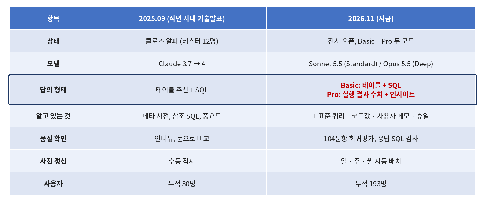

제일 크게 바뀐 건 답의 형태입니다. 작년 챗디의 답은 "이 테이블을 보시고, 이 SQL을 돌려 보세요"에서 끝났습니다. 지금은 Pro에서 검증된 쿼리를 실행해 숫자와 해석까지 돌려줍니다.

품질을 보는 방법도 바뀌었습니다. 작년에는 눈으로 비교했고, 지금은 104문항 회귀평가와 실제로 나간 SQL에 대한 감사 배치로 측정합니다.

1년 동안 프론트엔드 릴리즈 25번, 백엔드 main 반영 82일, 합쳐서 107번을 반영했습니다. 그사이 챗디를 한 번이라도 써 본 구성원은 30명에서 193명으로 늘었습니다.

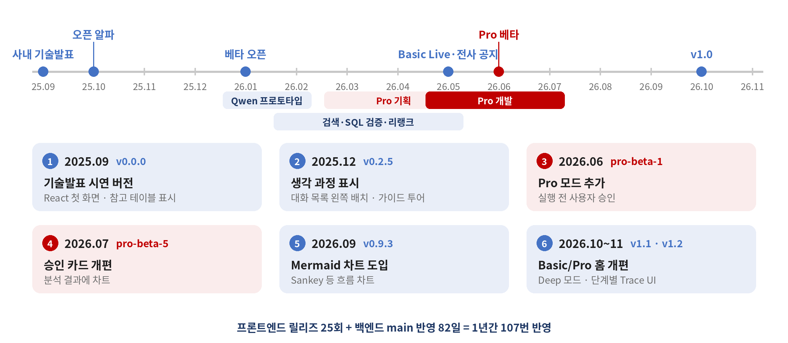

---

# Basic: 실행되는 SQL을 만들기까지

## 품질을 묻는 질문이 바뀌어 왔다

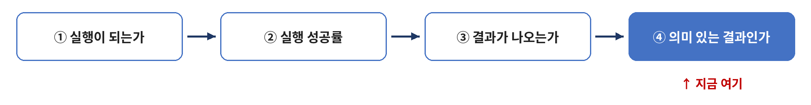

Basic 품질을 볼 때 던진 질문은 시기마다 달랐습니다. 하나를 넘고 나면 그다음 문제가 보였습니다.

| 단계 | 질문 | 보는 것 | 1년간 변화 |
|---|---|---|---|
| ① | 실행이 되는가 | 생성한 SQL에 문법·파싱 오류가 없는지 | 초기에는 문법 오류가 나는 쿼리가 약 30% |
| ② | 실행 성공률 | 실제 사용자에게 나간 SQL이 테이블 존재·EXPLAIN까지 통과하는지 | 41%(~7월) → 100%(11월) |
| ③ | 결과가 나오는가 | 실행은 되는데 0건이 나오는 경우 | 코드값 사전·사용자 메모로 WHERE 조건값 보강 |
| ④ | 의미 있는 결과인가 | 돌아가지만 의도한 숫자인지 | 지금 여기. 아직 사람이 확인 |

①과 ②는 문법과 스키마 문제라 자동으로 측정하고 고칠 수 있었습니다. 생성 단계에서 사내 SQL 작성 가이드로 검사해 실패하면 다시 만들게 했고, 배포 후에는 나간 SQL을 매주 다시 돌려 실패 원인을 분류했습니다.

③부터는 성격이 다릅니다. 문법이 맞아도 WHERE 절의 코드값이 틀리면 결과는 0건입니다. 모델 문제가 아니라 챗디가 사내 데이터를 얼마나 아느냐의 문제라서, 코드값과 사용자가 알려 준 지식을 사전으로 쌓는 쪽으로 풀고 있습니다.

④는 아직 자동으로 측정하지 못합니다. 결과가 나와도 그 숫자가 사업·기획에서 쓰는 기준과 같은지는 지금도 사람이 봅니다. 실행 오류는 1년 사이에 거의 사라졌고, 남은 문제는 "돌아가는데 맞는 숫자인가"입니다.

아래는 이 순서대로 무엇을 바꿨는지에 대한 이야기입니다.

## Basic 구조

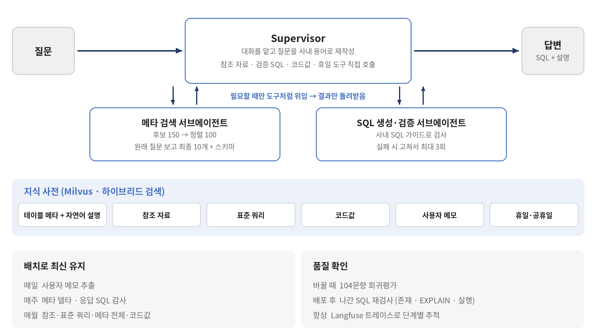

챗디 Basic은 Supervisor와 서브에이전트로 구성한 멀티에이전트 구조입니다. 여러 에이전트가 대등하게 대화를 주고받는 방식이 아니라, Supervisor 하나가 대화를 맡고 필요한 일만 서브에이전트에 위임하는 계층형입니다. 서브에이전트는 Supervisor가 도구처럼 호출하고 결과만 돌려받습니다. 최근 추가한 쿼리 튜닝만 예외로, 튜닝을 요청하면 대화를 튜닝 전용 에이전트로 넘깁니다.

질문이 들어오면 Supervisor가 참조 자료와 검증된 SQL부터 보고 질문을 사내 용어로 다시 씁니다. "매출"이 결제액인지 포인트 소진인지 같은 다의어를 여기서 풉니다. 그다음 메타 검색 서브에이전트가 테이블 후보를 넓게 찾아 최종 10개를 고르고, SQL 생성·검증 서브에이전트가 사내 SQL 작성 가이드로 검사해 실패하면 최대 세 번까지 다시 만듭니다.

## 검색: 후보 150개에서 10개까지

검색은 버전마다 바뀌었습니다. 처음엔 한글 질문과 영문 약어 테이블명 사이의 거리가 문제였고, 다음은 스키마에 없는 업무 지식, 그다음은 정답 테이블이 10위 밖으로 밀리는 문제였습니다. 지금은 이렇게 돌아갑니다.

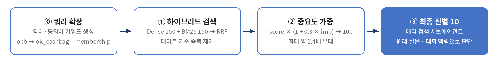

①②는 수식이라 매번 같은 결과가 나오고, 모델은 ⓪ 쿼리 확장과 ③ 최종 선별에만 씁니다. 중요도(imp)는 큐레이션, 실제 조회량, 테이블 접두어(log_/dw_/mart_)를 합쳐 계산합니다.

**왜 RRF를 썼나**

의미 검색 점수는 0.x, BM25 점수는 수십 단위라 그냥 더하면 한쪽이 묻힙니다. 점수 대신 등수로 합치면 한쪽 검색에만 걸린 테이블도 후보에 남습니다. 아래 예시에서는 BM25에만 걸린 D도 최종 후보에 들어갑니다.

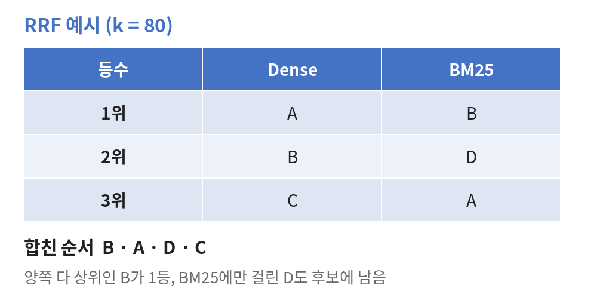

**왜 곱셈 가중인가**

자주 쓰는 테이블을 위로 올리고 싶었는데, 보너스를 더하는 방식으로 했더니 보너스가 RRF 점수 범위보다 커져서 질문과 상관없는 인기 테이블이 위를 차지했습니다. 곱하는 방식으로 바꾸면 검색 점수가 높은 후보 안에서만 우대가 됩니다. 중요도를 정규화해서 곱하는 방법도 해 봤는데, 중요도가 낮은 테이블은 오히려 깎이는 문제가 있어서 쓰지 않았습니다. 실제 코드는 이 정도로 단순합니다.

```python
def rerank_with_document_weight(results: list[dict], weight_field="importance"):
    """RRF 결과 점수에 도큐먼트별 importance 필드를 곱해서 최종 점수로 리랭킹."""
    for hit in results:
        importance = hit.get("entity", {}).get(weight_field, 0.0000000000000001)
        if "combined_score" in hit:
            base_score = hit["combined_score"]
        else:
            # RRF distance는 높을수록 관련도가 높으므로 그대로 사용
            base_score = hit.get("distance", 0.0)
        hit["final_score"] = base_score * (1 + DW_RATE * importance)   # DW_RATE = 0.3

    ranked_results = sorted(results, key=lambda x: x["final_score"], reverse=True)
    return ranked_results[:RERANK_LIMIT]                                 # RERANK_LIMIT = 100
```

**리랭크는 넣었다가 옮겼다**

정답 테이블이 10위 밖으로 밀리는 걸 해결하려고 Cross-Encoder와 LLM 리랭크를 비교했습니다. Cross-Encoder는 성능이 기대만큼 안 나왔고 실시간 GPU 비용도 커서 LLM 리랭크를 검색 단계에 넣었습니다. 그런데 검색할 때마다 LLM을 부르니 지연과 토큰이 계속 쌓였습니다. 다음 버전에서는 검색은 수식으로만 하고, 최종 선별만 서브에이전트에게 맡기는 구조로 옮겼습니다.

**문서 쪽도 바꿨다**

DDL을 통째로 임베딩하지 않고 테이블·컬럼·COMMENT 단위로 나눴습니다. 약어 컬럼에는 약어 사전과 LLM 배치로 자연어 설명을 미리 붙여 둡니다(`usr_acct_info` → user account information). 이 작업은 사내 GPU에서 오프라인 배치로 돌리기 때문에 온라인 LLM 비용은 따로 들지 않습니다.

## 사전: 넣었더니 더 틀린 경우도 있었다

챗디가 참조하는 지식은 지금 6종입니다.

| 사전 | 내용 |
|---|---|
| 테이블 메타 | DDL + 자연어 설명 |
| 참조 자료 | 사내 문서, 가이드, 서비스 목록, 에러코드, 암복호화 가이드 등 |
| 표준 쿼리 | 검증된 업무 SQL |
| 코드값 | 코드의 실제 값과 뜻 |
| 사용자 메모 | 대화에서 사용자가 알려 준 지식 |
| 휴일 | 영업일·공휴일 |

이 중 참조 사전은 한 번 크게 실패했습니다. 처음엔 자주 실행되는 쿼리 원문과 과거 질문-SQL 쌍을 그대로 넣었는데, 팀원 6명이 16문항으로 비교해 보니 오히려 나빠진 문항이 나왔습니다. 들여다보니 모델이 원문 SQL을 "참고"가 아니라 "정답"으로 따라가고 있었습니다. 권한 없는 뷰나 개인 임시 DB를 그대로 가져오기도 했고, 다른 서비스를 물었는데 엉뚱한 서비스 테이블을 쓰기도 했습니다. 자주 실행되는 쿼리 목록에도 만든 지 오래돼 지금은 돌아가지 않는 쿼리나, 개인 임시 테이블에 데이터를 쌓아 두고 뽑는 개인용 쿼리처럼 참고할 가치가 없는 것들이 섞여 있었습니다.

그래서 원문 SQL 대신 LLM으로 맥락·코드값·쿼리 패턴만 뽑은 정제본을 넣고, 검증된 SQL은 표준 쿼리 사전으로 따로 뺐습니다. 근거를 많이 넣는다고 좋아지는 게 아니라 어떤 모양으로 넣느냐가 중요하다는 걸 이때 배웠습니다.

**코드값 사전**

SQL이 틀리는 흔한 이유 중 하나가 WHERE 절의 코드값을 모르는 것이었습니다. 그렇다고 모든 테이블을 조회해서 코드값을 뽑을 수는 없어서, 코드 정의 테이블만 골라 담는 단계를 만들었습니다.

- 1단계는 조회 없이 메타데이터만 봅니다. 컬럼명 패턴, 의미 검색, 허용·제외 목록, 컬럼 수, 금액·건수 컬럼 유무로 후보를 거릅니다.
- 2단계에서만 실제로 조회하는데, 최신 파티션 1개에 LIMIT을 걸고 행 수가 일정 범위인 테이블만 적재합니다.

검수는 다섯 번 돌렸고, 오탐 검수 중에 규칙에 걸려 빠졌던 진짜 코드 정의 테이블을 다시 살려 내기도 했습니다. 컬럼이 많은 핵심 코드 마스터가 규칙에 걸리는 문제는 아직 예외 목록으로 메우고 있습니다.

**사용자가 알려 준 지식**

대화 중에 사용자가 "이 코드는 이런 뜻이다"라고 알려 주는 경우가 꽤 있습니다. 예전에는 그 지식이 그 대화에서 끝났습니다. 지금은 매일 새벽 Langfuse 트레이스에서 사용자가 단정한 지식만 뽑아 사전에 넣고, 다음 질문에서 참조하게 했습니다. 한 사용자가 알려 준 코드를 새 세션에서 먼저 쓰는 것도 확인했습니다. 다만 메모가 검색되고도 답에 안 쓰이는 경우가 아직 많아서 더 다듬어야 합니다.

**사람 손 없이 최신으로**

사전은 배치로 갱신합니다. 사용자 메모는 매일, 테이블 메타 변경분은 매주, 전체 사전은 매월 돌립니다. 예전에는 월 1회 전체 리셋만 있어서 반영도 늦었고 한 번 돌리는 데 반나절이 넘게 걸렸는데, 지금은 매주 바뀐 테이블만 골라 넣습니다. 수집 결과가 0건이면 멈추고 기존 데이터는 지우지 않게 해서, 배치가 잘못 돌아도 사전이 비지 않도록 했습니다.

## 품질 루프: 바꿀 때마다, 나간 뒤에도

예전에는 릴리즈할 때마다 들어오는 "뭔가 이상해졌어요", "쿼리 오류가 늘었어요", "이 테이블은 없는 건데요?", "이 테이블은 추천하면 안 돼요" 같은 피드백으로 품질을 짐작했습니다. Claude 3.7에서 4, 4.5로 모델을 올릴 때도 뭔가 달라진 건 분명했는데, 얼마나 좋아졌는지 나빠졌는지는 정확히 알 수 없었습니다.

숫자로 목표를 관리하고 싶어서, 챗디가 사용자에게 내보낸 SQL을 전부 모아 성공률을 측정해 봤습니다. 처음 나온 숫자가 41% 정도였습니다. 절반 넘는 SQL에서 오류가 났고, 사용자는 실패 로그를 챗디에 다시 붙여 넣어 고치기를 반복하고 있었습니다.

그래서 지금은 품질을 두 군데서 봅니다.

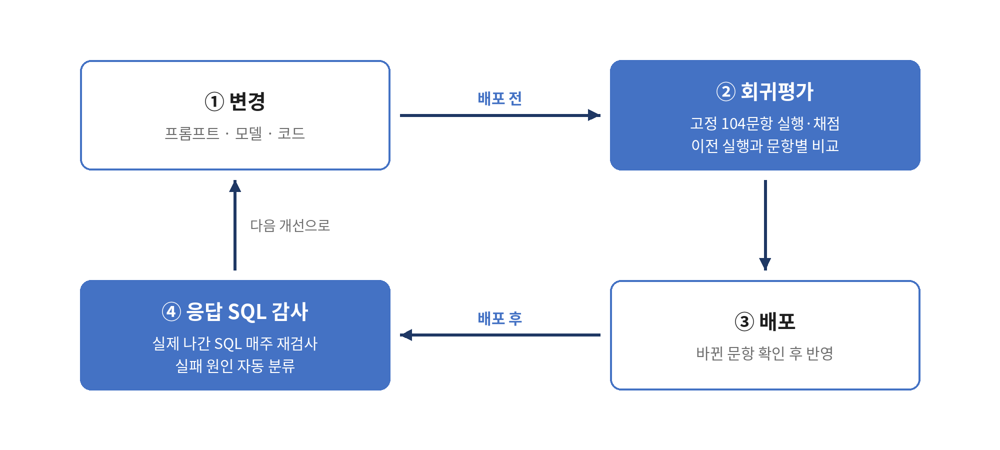

**회귀평가 (배포 전)**

프롬프트·모델·코드를 바꿀 때마다 고정 104문항을 Langfuse로 실행·채점하고, 이전 실행과 문항별로 비교합니다. 배포 관문으로 쓰고 있고 지금은 100% 통과합니다. 다만 정해 둔 질문만 보기 때문에 실사용에서 새로 생기는 문제는 못 잡습니다.

**응답 SQL 감사 (배포 후)**

그래서 실제로 사용자에게 나간 SQL을 매주 다시 검사합니다. 테이블·컬럼 존재 확인 → Hive EXPLAIN → 검증 환경 실행 순서로 보고, 실패 원인은 미존재 테이블 / 문법 / 파싱으로 자동 분류합니다. 여기서 성공은 EXPLAIN 통과 기준이고, 결과값까지 맞는지 본 건 아닙니다.

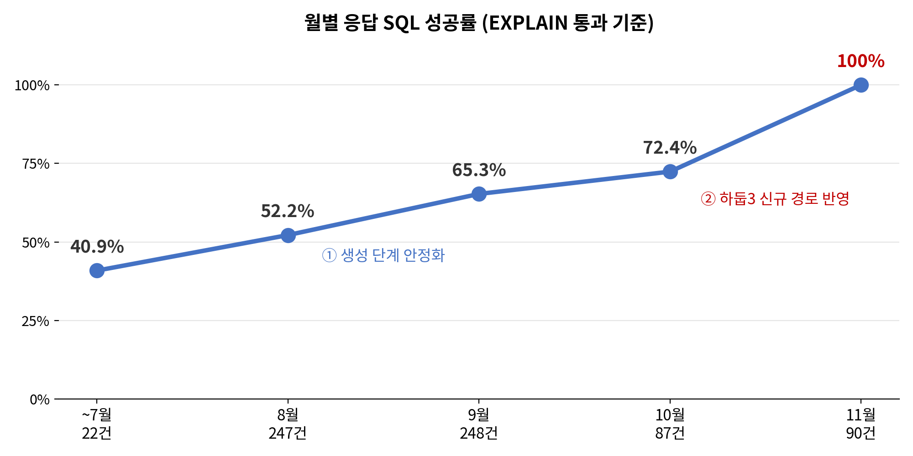

7월까지는 전체 SQL의 31.8%가 문법·파싱 오류로 실패했는데, 생성 단계에 가이드 검사와 재시도를 넣은 뒤인 9월에는 이 비율이 7%대로 줄었습니다. 9월 이후 성공률 증가가 둔화된 건 하둡3 클러스터 이관 시기와 겹쳐서입니다. 미존재 테이블 실패 대부분이 이관 전 구 경로를 참조한 경우였고, 메타데이터 사전에 신규 경로를 반영한 뒤 100%가 됐습니다. 이런 원인을 로그를 뒤지지 않고 분류 결과만 보고 알 수 있다는 게 감사 배치를 만든 가장 큰 이유였습니다.

## 아직 측정하지 못하는 것: 맞는 숫자인가

실행되는 것과 숫자가 맞는 건 다른 문제입니다. 같은 월 MAU를 묻는 질문을 반복해 봤는데, 모델이 매번 새로 만든 SQL은 돌릴 때마다 숫자가 조금씩 달랐습니다. 검증된 SQL을 예시로 주자 기존 사업·기획 자료와 거의 같아졌습니다.

지표의 정의는 사내에서 정한 사실이고, 모델이 추론해서 맞힐 수 있는 영역이 아니라고 판단했습니다. 그래서 Basic은 검증 SQL을 참고만 하고, Pro는 검증 SQL만 실행하도록 나눴습니다.

---

# Pro: 검증된 쿼리만 실행한다

## 왜 Pro가 필요했나

Basic 사용 로그를 보다가 방향을 다시 고민하게 된 사례가 있습니다. 한 사용자가 특정 이벤트로 처음 들어온 고객이 석 달 안에 다시 오는지 보려고 Basic에 닷새 동안 열한 번 질문했습니다. 챗디가 만든 쿼리를 돌려 보니 0건이 나와서 쿼리를 단계별로 쪼개 원인을 찾았고, 챗디가 Hive에서 막히는 CROSS JOIN을 만들어서 오류 메시지를 붙여 넣어 가며 두 번 고쳤습니다. 실행하고, 오류를 복사해 오고, 결과를 확인하는 건 모두 사용자 몫이었습니다.

이분은 오류 메시지를 붙여 넣어 가며 스스로 풀 수 있었지만, 모두가 그렇지는 않습니다. 당시 챗디라는 데이터 에이전트를 처음 접한 사용자들은 SQL을 물어보기보다 숫자나 SQL 실행 결과를 바로 원하는 경우가 많았습니다.

**사실 사용자가 데이터를 분석하는 목적은 SQL 자체가 아닙니다. 먼저 필요한 건 SQL을 실행한 결과이고, 궁극적으로 원하는 건 그 데이터에서 나오는 인사이트입니다.** 왜 사용자가 줄었는지 혹은 늘었는지, 어느 등급에서 이동이 있었는지, 트래픽과 매출은 어떻게 변했는지 같은 질문에 답하려면 챗디도 SQL을 넘어 실행 결과와 해석까지 돌려줘야 했습니다.

다만 규제 환경에서 모든 질문에 실행을 열 수는 없습니다. 그래서 위 사례처럼 매달 반복되는 분석부터, 매번 SQL을 새로 만드는 대신 사람이 검증한 쿼리로 등록해 두고 실행하는 방식을 택했습니다. 이게 Pro입니다.

두 달 뒤 같은 사용자가 같은 종류의 분석을 Pro에 물었을 때는 질문 한 번, 승인 한 번으로 등급별 결과와 해석을 받았습니다. 그때 Pro가 돌려준 해석을 수치만 가려 옮기면 이렇습니다.

> 4월 이벤트로 처음 방문한 고객 중 다음 달 다시 방문한 고객은 약 OO% 수준이고, 이후에는 비슷한 규모로 유지되고 있습니다. 이탈한 고객은 대부분 방문이 적은 L 등급이며, H 등급은 오히려 4월보다 늘었습니다. M 등급만 매달 줄고 있어 M·L 등급은 리텐션 관리가 필요하고, H 등급은 지금 방식을 유지하는 것을 권장합니다.

## 구조와 설계 원칙

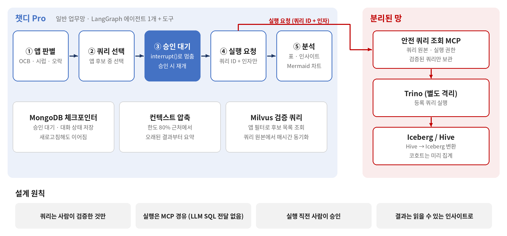

Pro는 망을 기준으로 둘로 나뉩니다. 챗디 Pro는 일반 업무망에서 LangGraph로 돌고, 쿼리 원본과 실행 권한은 분리된 망의 안전 쿼리 조회 MCP가 가지고 있습니다. 이 MCP는 사람이 검증한 쿼리만 보관하고 실행하는 사내 MCP(Model Context Protocol) 서버이고, 에이전트는 도구 호출로 쿼리 ID와 인자만 넘깁니다.

Pro에는 Basic과 달리 서브에이전트가 없습니다. 에이전트 하나가 후보 조회, 쿼리 실행, 결과 복원, 되묻기, 범위 밖 안내 같은 도구를 호출하며 루프를 돌고, 실행 승인과 차트 생성만 LangGraph의 별도 노드로 뺐습니다. 차트를 따로 뺀 데는 이유가 있습니다. 처음엔 분석과 차트를 한 번에 맡겼는데, 모델이 차트를 다음 턴으로 미루려고 가짜 도구 호출을 붙이는 일이 생겼습니다. 그래서 차트는 도구 없는 별도 호출로 만들어 분석 답변 뒤에 붙입니다.

원칙은 네 가지로 잡았습니다.

- 쿼리는 사람이 검증한 것만 실행합니다.
- 실행은 안전 쿼리 조회 MCP를 거칩니다. Pro는 LLM이 만든 SQL을 넘기지 않고, 실제 SQL은 MCP가 가진 원본으로 실행됩니다.
- 실행 직전에 사람이 승인합니다.
- 결과는 읽을 수 있는 인사이트로 돌려줍니다. 숫자는 코드가 계산하고 모델은 해석만 합니다.

## 쿼리 선택: 유사도만으로는 부족했다

처음에는 등록된 검증 쿼리 전체 목록을 모델 컨텍스트에 넣고 고르게 했습니다. 쿼리가 늘수록 토큰도 늘고 고르는 정확도도 떨어져서, 질문으로 검색해 후보를 좁히려고 하이브리드 검색을 붙여 봤습니다. 그런데 앱마다 쿼리가 이름만 다른 같은 템플릿이다 보니 유사도로는 앱이 구분되지 않았습니다. "OCB 앱 MAU"를 물었는데 다른 앱의 MAU 쿼리(0.405)가 OCB DAU 쿼리(0.361)보다 위에 올라왔고, 임계값을 어디에 둬도 깔끔하게 갈리지 않았습니다.

그래서 유사도 대신 메타데이터로 풀었습니다. 쿼리를 등록할 때 설명 맨 앞에 `[OCB / SYRUP / OLOCK]` 같은 앱 태그와 용도·제약을 정해진 형식으로 적게 하고, 에이전트가 질문에서 앱을 판별해 도구에 넘기면 그 앱 태그가 붙은 쿼리만 받아 그 안에서 고르게 했습니다. 거기서 못 찾으면 전체 목록으로 한 번 넓혀 다시 봅니다. 이렇게 바꾸고 입력 토큰은 21.5%, 후보 수는 28.6% 줄었습니다. 구조가 비슷한 대상끼리는 임베딩을 다듬는 것보다 구분할 메타데이터를 미리 정리해 두는 게 훨씬 효과가 컸습니다.

쿼리를 잘 골랐는지도 따로 평가합니다. 후보 안에 정답이 있는지(Candidate Recall), 실행할지·되물을지·지원 불가로 안내할지(Action Accuracy), 맞는 쿼리를 골랐는지(Query Selection Accuracy) 세 가지를 다 맞혀야 통과입니다. 대상이나 기간이 빠진 질문이면 되묻는지, 범위 밖이면 안내하는지까지 봅니다.

## 승인 대기: 멈췄다가 이어서 실행하기

실행 직전에 그래프를 멈추고 사용자 승인을 기다려야 했습니다. LangGraph의 `interrupt()`로 멈추고 상태는 체크포인터에 저장합니다. 처음엔 Redis로 설계했는데 다중 워커에서 문제가 생겨 MongoDB로 바꿨고, Basic도 같은 방식으로 맞췄습니다. 덕분에 새로고침을 해도 승인 대기 상태가 그대로 이어집니다. 사용자는 아래 화면에서 어떤 데이터를 어떤 조건으로 조회할지 확인하고 실행을 승인합니다.

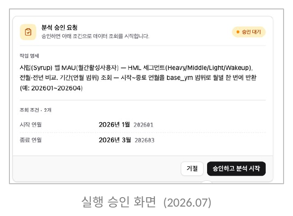

여러 달을 조회하는 질문은 처음에 달마다 승인을 받다 보니 네 번을 눌러야 했는데, 기간 범위 쿼리로 묶어서 한 번으로 줄였습니다.

## 1분 안에 답하려면, 파이프라인부터 다시

대화형 서비스라면 1분 안에 조회 결과와 해석까지 돌려줘야 합니다. Hive는 대용량 데이터를 분산 처리하는 데는 맞지만, 에이전트가 MCP로 데이터를 빠르게 조회해 LLM에 쓰는 용도에는 맞지 않습니다.

그렇다고 기존 데이터를 응답이 빠른 다른 DB로 다시 적재하면 비용이 두 가지 생깁니다.

1. 인프라 구축 비용
2. 데이터 트랜스퍼 비용

둘 다 결국 관리 비용으로 돌아오고, 얻는 것보다 운영 부담이 더 크다고 봤습니다. 그래서 인프라를 새로 짓지 않고 데이터 이동은 최소로 줄이는 방향으로 조회 엔진을 검토했고, 이미 사내에서 운영 중이던 Trino에 Iceberg 테이블 포맷을 더하고 실시간 적재와 배치 파이프라인을 다시 설계하는 쪽으로 정했습니다.

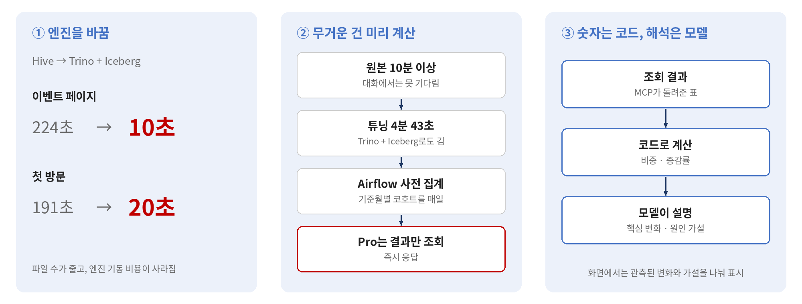

Trino + Iceberg로 바꾼 것만으로 주요 조회 시간이 10분의 1 이하로 줄었습니다(Trino 도입 배경은 [이전 글](https://techtopic.skplanet.com/trino/)에서 소개했습니다). 그래도 튜닝 후 4분이 넘던 코호트 분석 같은 무거운 쿼리는 Airflow에서 기준월별로 미리 집계해 두고, Pro는 결과만 읽습니다. 비중·증감률 같은 숫자는 코드가 계산하고, 모델은 그 결과를 보고 어디서 변화가 컸는지와 가능한 설명만 정리합니다.

## 어려웠던 점 ① 길어지는 컨텍스트

Pro 대화는 하나의 세션(thread) 안에서 계속 이어지고, 대화 상태는 LangGraph 체크포인트로 MongoDB에 저장됩니다. 문제는 쿼리 조회 결과 원본까지 체크포인트에 그대로 남아 매 턴 모델로 다시 넘어간다는 점이었습니다. 결과 행이 많을수록 턴마다 입력 토큰이 선형으로 늘었습니다. 6월에 Sonnet 4.5(200K)에서 처음 한도를 넘었을 때는 Pro 모델만 1M 컨텍스트를 지원하는 Sonnet 4.6으로 분리해 넘어갔지만, 쌓이는 구조는 그대로였습니다. 결국 8월에는 같은 1M 한도의 Sonnet 5에서 9턴에 약 77만 토큰, 10턴에 다시 한도를 넘었습니다.

게다가 한도 안에 들어간다고 다 기억하는 것도 아니었습니다. 대화가 길어질수록 앞에서 본 중요한 숫자를 놓치는 일이 생겼습니다. 컨텍스트 한도는 넣을 수 있는 양이지 기억하는 양이 아닙니다.

그래서 **조회 결과 원본은 MongoDB 체크포인트에 그대로 두고, 모델에는 요약본과 원본 참조 ID만 넘기는** 구조로 바꿨습니다. 사용자 화면의 표는 원본 그대로 보여 주고, 모델 입력에서만 이전 조회 결과를 컬럼, 전체 행 수, 앞 5행으로 줄입니다. 생략된 수치가 필요하면 모델이 추정하지 않고 도구를 불러 원본을 꺼내 옵니다.

```json
{
  "summarized": true,
  "result_ref": "tool-call-id",
  "columns": ["날짜", "가입자수"],
  "row_count": 100,
  "rows": [["2026-09-01", 1200], ["2026-09-02", 1350], "... 앞 5행"],
  "note": "생략된 행의 수치가 필요하면 추정하지 말고 expand_query_result를 호출하세요."
}
```

이렇게 바꾸고 나서 새 질문의 입력은 3만 토큰 안팎으로 돌아왔고, 11턴 이후에도 정상 동작했습니다.

다만 다음 질문부터 무조건 압축했더니, 이전 결과끼리 비교하는 대화에서 원본을 다시 꺼내는 일이 너무 잦았습니다. 원본을 많이 남기면 비교는 정확해지지만 한도와 기억 문제가 생기고, 너무 줄이면 복원 호출이 늘어납니다. 그래서 지금은 평소에는 원본을 두고, 입력이 모델 한도의 80% 근처에 왔을 때만 오래된 결과부터 하나씩 요약합니다. 세션별 컨텍스트 사용량도 화면에서 볼 수 있게 했습니다.

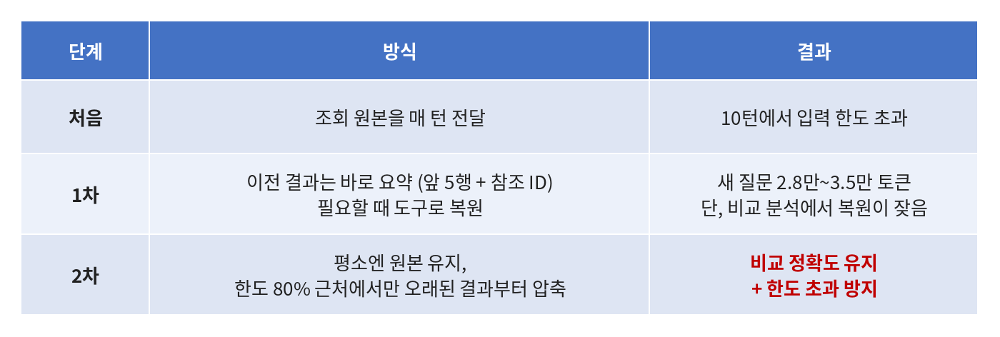

압축 로직은 아래와 같습니다. 만들면서 한 번 걸린 부분이 주석에 있는데, 요약한다고 ToolMessage를 지워 버리면 tool_use와 짝이 맞지 않아 Bedrock이 바로 오류를 냅니다. 메시지는 남기고 content만 바꿔야 합니다.

```python
def compact_history(messages, *, token_budget, count_tokens=estimate_message_tokens):
    """입력 토큰이 예산을 넘을 때만 오래된 조회 결과부터 요약본으로 교체한다.

    ToolMessage를 제거하지 않고 content만 바꾼다. 지우면 tool_use에 대응하는
    tool_result가 사라져 Bedrock이 ValidationException을 던진다.
    """
    current_tokens = count_tokens(messages)
    boundary = last_human_index(messages)          # 이번 질문의 결과는 건드리지 않음
    if boundary <= 0 or current_tokens <= token_budget:
        return messages, False

    compacted, shrunk = list(messages), 0
    for i in range(boundary):                       # 오래된 결과부터
        target = _compactable(messages[i])
        if target is None:
            continue
        result, result_ref = target
        summary = json.dumps(_summarize(result, result_ref), ensure_ascii=False)
        candidate = list(compacted)
        candidate[i] = messages[i].model_copy(update={"content": summary})
        candidate_tokens = count_tokens(candidate)
        # 행이 적으면 note 길이 탓에 요약본이 원본보다 커진다. 그때는 원본을 둔다.
        if candidate_tokens >= current_tokens:
            continue
        compacted, current_tokens, shrunk = candidate, candidate_tokens, shrunk + 1
        if current_tokens <= token_budget:
            break

    return (compacted, True) if shrunk else (messages, False)
```

**80%를 어떻게 판단하나: 보내기 전에 토큰 세기**

80% 기준으로 압축하려면 모델에 보내기 **전에** 입력 토큰 수를 정확히 알아야 합니다. 응답에 붙어 오는 usage는 이미 호출한 뒤에야 알 수 있고, OpenAI와 달리 Claude의 토크나이저는 공개돼 있지 않습니다. Bedrock 런타임의 CountTokens API는 지원하는 모델이 제한적이었습니다.

그래서 사내 Bedrock 게이트웨이에 `/chat/count-tokens` 엔드포인트를 추가하고, 내부에서는 Bedrock Mantle의 Anthropic 네이티브 `count_tokens` 엔드포인트를 SigV4로 서명해 직접 호출하게 했습니다. 이 엔드포인트는 서울 리전을 지원하지 않아 us-east-1, ap-northeast-1 순서로 시도하고, 연결 실패나 5xx면 다음 리전으로 넘어갑니다.

```python
MANTLE_COUNT_TOKENS_URL = "https://bedrock-mantle.{region}.api.aws/anthropic/v1/messages/count_tokens"

def _call_mantle_count_tokens(self, payload: dict) -> dict:
    credentials = _mantle_boto_session.get_credentials().get_frozen_credentials()
    body = json.dumps(payload).encode("utf-8")
    last_error = None

    for region in BEDROCK_MANTLE_REGIONS:          # 기본 us-east-1, ap-northeast-1
        url = MANTLE_COUNT_TOKENS_URL.format(region=region)
        aws_request = AWSRequest(
            method="POST", url=url, data=body,
            headers={"Content-Type": "application/json", "anthropic-version": "2023-06-01"},
        )
        SigV4Auth(credentials, "bedrock-mantle", region).add_auth(aws_request)

        try:
            resp = requests.post(url, data=body, headers=dict(aws_request.headers), timeout=30)
        except requests.exceptions.RequestException as e:
            last_error = HTTPException(status_code=500, detail=f"Mantle 요청 실패({region}): {e}")
            continue                                    # 연결 실패는 다음 리전으로
        if resp.ok:
            return resp.json()                          # {"input_tokens": ...}
        last_error = HTTPException(status_code=resp.status_code, detail=resp.text)
        if resp.status_code < 500:
            raise last_error                            # 4xx는 리전을 바꿔도 같으므로 즉시 실패

    raise last_error
```

챗디 Pro는 실제 LLM 호출과 같은 메시지 형식·모델·도구 정의로 이 API를 불러 토큰을 셉니다. API가 실패하거나 지원하지 않는 모델이면 UTF-8 1.5바이트당 1토큰으로 추정하는 방식으로 자동 전환합니다. 도입 후 계산값과 실제 입력 토큰이 일치하는 것도 확인했습니다.

**압축 이후에도 남은 문제**

압축을 넣은 뒤에도 결과표 자체가 큰 경우는 여전히 무겁습니다. 아래는 10월의 실제 한 대화를 턴별로 본 것입니다. 페이지별 PV처럼 행이 많은 결과표가 들어간 18번째 턴에서는, 그 턴 안에서 모델을 세 번 부르는 동안 매번 75만~80만 토큰이 실렸습니다. 압축은 이전 턴의 결과만 줄이고 지금 질문의 결과는 건드리지 않기 때문에, 이번 턴에서 받은 큰 결과표는 그대로 실린 것입니다. 호출이 한도를 넘지는 않았지만 턴 전체 합계는 236만 토큰으로 평소(약 5만 토큰)의 46배였고, 이후 턴들도 한동안 무겁게 이어졌습니다.

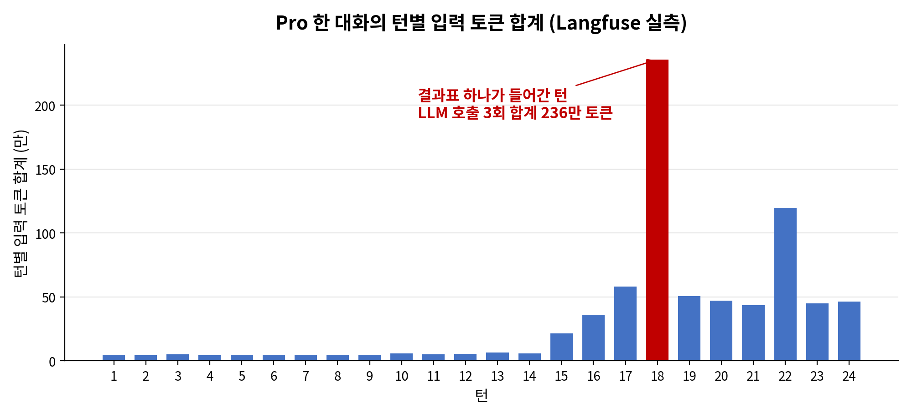

압축은 쌓인 이력이 한도를 넘지 않게 막아 줄 뿐, 처음부터 큰 결과를 작게 만들어 주지는 않습니다. 그래서 앞으로는 실시간 로그처럼 결과 행이 많은 쿼리는 원본을 넘기지 않도록 사전 집계나 조회 행 수 상한을 두고, 주제가 바뀌면 새 대화를 열도록 안내하는 것도 같이 보고 있습니다.

## 어려웠던 점 ② 같은 지표, 다른 쿼리

두 번째 어려움은 기술 문제가 아니었습니다. 같은 이름의 지표인데 기획자, 데이터 사이언티스트, 데이터 엔지니어가 쓰는 쿼리가 다 달랐습니다. 어느 쪽이 맞는지는 AI Data Platform팀이 정할 수 없고, 그 숫자로 장표를 쓰는 조직이 정해야 합니다.

데이터 성격에 따라서도 숫자가 달라집니다. Pro는 속도 때문에 실시간 로그 테이블을 쓰는데, 비교 대상 리포트가 배치 로그 기준이면 같은 조건이어도 숫자가 다를 수 있습니다. Pro에 쿼리를 등록할 때 쿼리를 짜는 시간보다 "누구 기준인가"를 맞추는 시간이 더 들었습니다.

참고로 Pro에 넣을 쿼리를 만들 때 저희 팀도 Basic을 썼습니다. 테이블을 찾고 초안을 잡은 다음, 기획팀과 결과를 맞추고 기간을 파라미터로 바꿔 등록했습니다. Basic과 Pro가 따로 노는 기능이 아니라 이어져 있다는 걸 만들면서 느꼈습니다.

---

# 운영하며 만난 병목

1년 동안 느려지거나 오류가 날 때마다 원인을 찾아 들어갔는데, 원인은 매번 다른 곳에 있었습니다.

| 증상 | 원인 | 조치 |
|---|---|---|
| 긴 답변이 중간에 끊김 | Nginx 타임아웃 60초 | 300초로 변경 |
| 동시 10명에서 지연, 로그인 3~5초 | 백엔드 워커 부족, 로그인 API 스레드 락 | 워커 증설, 로그인 100ms |
| 지난 대화 목록이 비어 보임 | Langfuse 풀스캔으로 ClickHouse 타임아웃 → 빈 목록 반환 | Trace API로 최신 질문만 조회 |
| 모델 교체·멀티에이전트 재도입 후 2분 타임아웃 | Bedrock 게이트웨이가 단일 워커 + 이벤트 루프 블로킹으로 스트리밍을 사실상 1건씩 처리 | 워커 4개, 타임아웃 6분 |
| 운영에서만 사고과정 메시지가 답변과 한꺼번에 출력 | Nginx 버퍼링·중간 압축 | 버퍼링·압축 방지 헤더 |
| Bedrock 503 | 글로벌 크로스 리전 추론 중 특정 리전 장애 | 우회 경로, 재시도 1→3회 |

원인을 찾을 때 근거는 매번 Langfuse 트레이스였습니다. 지금은 Bedrock 게이트웨이 에러 알림과 토큰 사용량 알림까지 붙여 두었습니다.

모델을 바꾸고 생긴 일도 하나 있습니다. Sonnet 5.5로 바꾼 뒤 진행 메시지가 줄어서 사고과정 요약을 화면에 붙였는데, 영어로 된 내부 추론까지 그대로 보이게 됐습니다. 지금은 단계별로 접어 두는 Trace UI로 바꿨습니다.

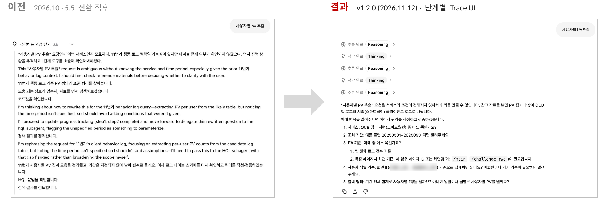

응답 성능은 그대로였는데, 사용자 반응은 완전히 달랐습니다.

---

# 해 봤지만 안 된 것

| 시도 | 결과 | 남긴 것 |
|---|---|---|
| 사내 GPU에 Qwen3-235B를 올려 대화 대체 | 할루시네이션, 출력 길이 한계로 실시간 대화는 어려움 | 배치 정제·요약은 사내 모델로 |
| 멀티에이전트 1차 시도 (병렬 도구 호출) | 검색이 대화 맥락 없이 실행, 비용 우려로 중단 | 8월에 Supervisor + 서브에이전트 구조로 다시 도입 |
| Cross-Encoder 리랭크 | 성능 미달, 실시간 GPU 비용 | LLM 리랭크 → 서브에이전트 선별 |
| 어려운 질문 1건이 78만 토큰 사용 | 비용 급증 | 일간 토큰·요금 알림 배치 |
| Pro 쿼리 선택에 하이브리드 검색 | 앱만 다른 쿼리 구분 불가 | 앱 태그 메타데이터 필터 + 모델 선택 |
| 차트 라이브러리로 직접 렌더링 | 유지보수 부담, LLM이 만든 차트 코드 오류 | Mermaid로 교체 |
| 참조 사전에 원문 SQL 적재 | 정답처럼 따라가서 더 틀림 | 정제본 + 표준 쿼리 분리 |

지식그래프(GraphRAG)도 검토했지만 지금은 보류했습니다. 벡터 DB와 에이전트 성능을 올리는 게 먼저였고, 인프라와 기술 스택을 무작정 늘리는 것도 운영 입장에서는 병목이 된다고 봤습니다.

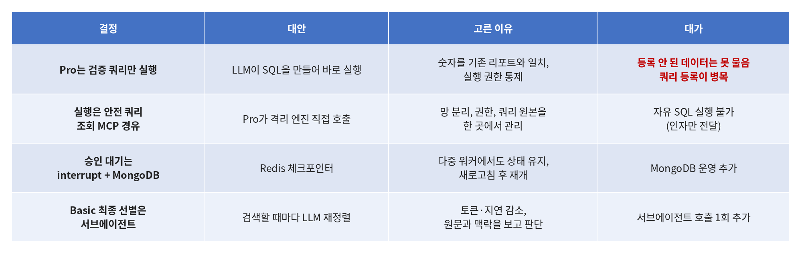

1년 동안 내린 설계 결정을 한 줄로 줄이면, **정확도와 통제를 먼저 골랐고 커버리지와 속도를 대가로 내줬습니다.** 그 대가가 제일 크게 드러나는 곳이 Pro의 커버리지입니다. Pro에 연동된 데이터는 처음 7개에서 58개로 늘었지만, 아직 "연동된 데이터가 없다"고 안내하는 질문이 적지 않습니다.

---

# 1년 해 보고 배운 것

작년 사내 기술발표에서 RAG 기반 서비스의 품질 비중을 임베딩 50%, LLM 30%, 프롬프트 20%라고 말했었습니다. 1년 운영해 보고 다시 쓰면 아래와 같습니다. 측정한 수치가 아니라, 직접 운영하면서 체감한 비중을 제 나름대로 정리한 것입니다.

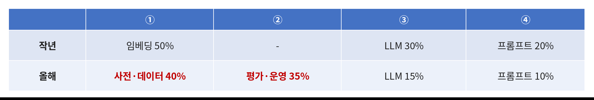

**사전·데이터 40%**

"지난달 구매자가 왜 줄었어?"라는 질문 하나에도, 전액 취소한 사람을 구매자로 볼지, 집계가 마감됐는지, 어느 SQL이 공식 기준인지 같은 판단이 들어갑니다. 전부 사내에서 정한 사실이고 모델은 알 수 없습니다. 사내 데이터는 외부에 공개된 적이 없으니, 스키마만 아무리 잘 넣어 줘도 범용 LLM이 바로 돌아가는 SQL을 만들기는 어렵습니다. 정의가 없으면 사전을 채우고, 정의가 있는데 엉뚱한 SQL을 가져오면 검색을 고칩니다.

[LinkedIn의 Text-to-SQL 사례](https://arxiv.org/abs/2507.14372)에서도 스키마만 줬을 때 9%였던 쓸 만한 SQL 비율이, 예시 쿼리와 속성 정보를 넣자 49%까지 올라갔다고 합니다.

**평가·운영 35%**

챗디는 개발자가 머릿속에 그린 대로 만들 수 있는 서비스가 아니었습니다. 사용자는 바쁘고, 불편한 점을 콕 집어 말해 주지 않는 경우가 많습니다. 그래서 피드백을 기다리기보다 사용 패턴을 분석해야 했습니다. 처음 온 사용자가 원한 게 SQL이 아니라 데이터였다는 것도 로그를 보고서야 알았습니다.

**LLM 15%**

실제로는 20% 가까이 됩니다. 가설과 후속 조회가 많은 인사이트일수록 모델 차이가 큽니다. 정의와 SQL 결과를 다 넣어 줬는데도 틀린다면 그때는 모델 문제입니다.

**프롬프트 10%**

보기 좋은 답을 만드는 문구는 이제 AI가 더 잘 씁니다. 다만 사내 SQL 가이드나 데이터 규칙을 지키게 하는 하네스와 가드레일은 직접 튜닝해야 합니다. 이건 회사마다 달라서 운영 경험이 필요합니다.

정리하면, 품질을 정한 건 모델보다 챗디가 무엇을 아느냐, 그리고 사용자가 어디서 막히는지 저희가 아느냐였습니다.

---

# 앞으로 할 것

- **Basic도 쿼리 실행까지**: 간단한 집계부터 실행해 숫자로 답하는 걸 검토하고 있습니다. Pro 때처럼 개인정보가 없는 범위부터 열고, 실행 권한·개인정보 검사·쿼리 부하·결과 검증 범위를 같이 정하려 합니다.
- **실행 전 판단은 분류 엔진에**: Basic으로 보낼지 Pro로 보낼지, SQL이 개인정보를 노출하는지 같은 판단을 생성 모델에 다 맡기면 느리고 비싸고 결과도 들쭉날쭉합니다. 이런 판단은 분류 엔진에 맡기는 방향으로 프로토타입을 만들고 있습니다.
- **쿼리 튜닝**: 무거운 쿼리를 받아 튜닝안과 근거를 내주는 기능을 열었습니다. 배치 부하 요청에 이 기능을 적용하는 것부터 해 보려 합니다.
- **묻기 전에 먼저 보내기**: Pro에서 만든 질문을 스케줄로 등록해 두면 정기적으로 실행해서 보고서로 보내 주는 기능입니다. 범용 워크플로우 도구도 검토했는데 안전 쿼리 조회 MCP와 연동하는 데 제약이 있어서 스케줄러를 직접 만들고 있습니다.
- **Pro로 옮길 요청 찾기**: 지난 3년치 데이터 분석 요청 이력을 분류해서, 반복해서 들어오고 정해진 쿼리로 답이 나오는 요청부터 Pro 전환 후보로 고르고 있습니다.
- **보안 영역으로 확장**: 서비스 데이터뿐 아니라 보안 관련 로그까지 수집·분석 대상으로 넓혀, 이상 징후를 탐지하고 AI가 분석까지 돕는 방향을 검토하고 있습니다.
- 그 밖에 사용자별 지시문, 파일 업로드 분석도 준비하고 있습니다.

조금 더 길게 고민하고 있는 건 Basic과 Pro의 통합입니다. 지금 두 기능은 일부 데이터를 같이 참조하지만, 따로 개발되어 왔고 에이전트 구조도 다릅니다(Basic은 Supervisor + 서브에이전트, Pro는 에이전트 하나 + 도구). 두 모드의 차이를 알고 골라 쓰는 분도 있지만 헷갈려하는 분도 많아서 통합을 검토하고 있는데, 코드 수준에서 합치기가 쉽지는 않습니다.

개인적으로는 RAG 기반 에이전트가 구조가 복잡해질수록, 하나의 창구로 여러 기능을 다 제공하는 데는 어느 정도 한계가 있다고 봅니다. 저희가 쓰는 AI 도구들도 목적이나 기능별로 창구가 나뉘어 있는 게 같은 이유가 아닐까 싶습니다. 그래도 사용자 입장에서는 하나로 묻는 게 편하기 때문에, 장기적으로는 통합하는 방향을 검토하려고 합니다.

---

# 결론

1년 전 챗디는 테이블을 찾아 주는 서비스였고, 지금은 실행 가능한 쿼리와 검증된 숫자로 답하는 서비스가 됐습니다. 그때 남긴 두 숙제 중 품질 평가는 회귀평가와 응답 SQL 감사로 측정할 수 있게 됐고, 쿼리 실행은 Pro를 통해 개인정보가 없는 데이터부터 열었습니다. 처음에 말한 두 가지에 비춰 보면, Basic은 SQL을 몰라도 데이터에 다가갈 수 있게 진입장벽을 낮췄고, Pro는 검증된 쿼리로 매번 직접 쿼리를 짜고 고치다 실패하는 비용을 줄였습니다. 내년에는 묻기 전에 먼저 알려 주고 인사이트까지 돕는 쪽으로 가려고 합니다.

첫 발표 때 "챗디 같은 프로젝트는 운영을 전제로 하니 내년 모습이 더 기대된다"고 말했었는데, 1년 운영해 보니 정말 그랬습니다. 챗디는 데이터 플랫폼 운영에서 출발한 프로젝트입니다. DIC를 오래 운영하면서 사용자를 직접 지원해 온 엔지니어들이, 그 과정에서 쌓인 고민을 AI로 풀어 보려고 만들었습니다. 기존 플랫폼의 개발과 운영·유지보수, 여기에 신규 버전 하둡(하둡3) 클러스터로의 무중단 마이그레이션까지 함께 마무리하면서 챗디를 만들다 보니 업무량이 적지 않았지만, 그 덕분에 처음부터 운영을 전제로 했고, 실제 환경에서 돌아가는 것과 실제 사용자가 쓰는 것을 기준으로 만들어 왔습니다. 이 점이 시간이 갈수록 챗디만의 강점이 될 거라고 생각합니다. 써 주시는 분이 늘수록 챗디도 좋아지는 구조라, 앞으로도 사용 패턴을 보면서 계속 고쳐 나가겠습니다.

마지막으로 이 모든 과정을 함께해 준 AI Data Platform팀 팀원분들께 감사드립니다. 챗디를 개발하면서 방향을 잡고 요구사항이 계속 고도화되는 동안, 그에 맞춰 검색 구조를 몇 번씩 갈아엎고, 사전 배치를 만들고, Pro의 승인·실행 흐름과 화면을 하나하나 구현한 건 모두 팀원분들이었습니다. 그리고 챗디는 지금도 써 주신 분들의 피드백과 대화 기록, 사용 데이터로 자라고 있습니다. 앞으로도 팀원분들, 그리고 사용자분들과 함께 챗디를 만들어 가겠습니다.

감사합니다.
