# 버그 티켓, AI에게 맡겨봤습니다 — QUBA 개발기

> QA가 등록한 Jira 버그 티켓을 AI Agent가 먼저 조사하고, 원인과 수정안까지 제안한다면 어떨까요? 사이드 프로젝트로 시작한 버그 처리 자동화 Agent ‘QUBA’의 설계 과정과, 분석 품질을 좌우한 데이터 임베딩·RAG 구축, 그리고 실제 티켓으로 측정한 효과까지 공유합니다.

**이학성 · 하동우 · 민경윤** · VAS개발팀
`#AI Agent` `#LangGraph` `#MCP` `#RAG` `#임베딩`

---

## 목차

**1부 · 왜 만들었고, 어떻게 생겼나**

1. [시작은 작은 호기심이었습니다](#시작은-작은-호기심이었습니다)
2. [버그 하나를 고치기까지, 시간은 어디서 새고 있을까](#버그-하나를-고치기까지-시간은-어디서-새고-있을까)
3. [AI Agent가 들어갈 수 있는 네 개의 틈](#ai-agent가-들어갈-수-있는-네-개의-틈)
4. [다른 팀은 어떻게 하고 있을까](#다른-팀은-어떻게-하고-있을까)
5. [사례에서 찾은 세 가지 설계 원칙](#사례에서-찾은-세-가지-설계-원칙)
6. [왜 LangGraph였나](#왜-langgraph였나)
7. [QUBA 아키텍처 한눈에 보기](#quba-아키텍처-한눈에-보기)

**2부 · 티켓 하나가 리포트가 되기까지**

8. [7개 노드로 흐르는 파이프라인](#7개-노드로-흐르는-파이프라인)
9. [정보 수집 — fetch_ticket](#정보-수집--fetch_ticket)
10. [문맥 보강 — enrich_context](#문맥-보강--enrich_context)
11. [분석과 검증 — synthesize](#분석과-검증--synthesize)

**3부 · 근거는 어디서 오는가**

12. [분석 근거는 어디서 오는가](#분석-근거는-어디서-오는가)
13. [임베딩: 의미를 좌표로 바꾸는 일](#임베딩-의미를-좌표로-바꾸는-일)
14. [임베딩 이전에 결정되는 것](#임베딩-이전에-결정되는-것)
15. [청킹 실패가 임베딩 실패로 보였다](#청킹-실패가-임베딩-실패로-보였다)
16. [데이터 공급망을 분리하다](#데이터-공급망을-분리하다)
17. [벡터는 어떻게 검색되는가](#벡터는-어떻게-검색되는가)
18. [벡터 검색만으로 부족한 이유](#벡터-검색만으로-부족한-이유)
19. [후보 생성과 정밀 판정을 분리하다](#후보-생성과-정밀-판정을-분리하다)
20. [점수 분포를 이해해야 confidence가 된다](#점수-분포를-이해해야-confidence가-된다)
21. [벡터 위에 구조화된 연결을 더한다](#벡터-위에-구조화된-연결을-더한다)

**4부 · 그래서 효과가 있었나**

22. [비용과 시간으로 따져보기](#비용과-시간으로-따져보기)
23. [마치며](#마치며)

---

<a id="시작은-작은-호기심이었습니다" style="display:block;scroll-margin-top:8rem"></a>

## 시작은 작은 호기심이었습니다

QUBA는 `Quality Bug Assistants`의 약자로, 한마디로 **버그 처리 자동화 AI Agent**입니다. 출발점은 단순한 질문이었습니다.

> **“QA 테스트 후 쌓이는 Jira 버그 티켓을 AI에게 맡기면, 버그 처리 과정도 자동화할 수 있지 않을까?”**

개발자는 생각보다 많은 시간을 버그를 분석하고 수정하는 데 씁니다. 이 구간에 AI를 잘 끼워 넣으면 팀 전체의 생산성을 꽤 끌어올릴 수 있겠다는 기대로 팀 내 매니저 세 명이 사이드 프로젝트를 시작했습니다.

> ℹ️ **아직 개발 중인 프로젝트입니다**
> QUBA는 완성된 제품이 아니라, 실제 업무 적용을 목표로 계속 테스트하며 다듬고 있는 프로젝트입니다. 이 글은 설계와 아키텍처, 파이프라인 내부 동작, 분석 품질을 좌우한 데이터 임베딩·RAG 구축, 그리고 실제 티켓으로 측정한 효과까지를 한 번에 정리한 기록입니다.

<a id="버그-하나를-고치기까지-시간은-어디서-새고-있을까" style="display:block;scroll-margin-top:8rem"></a>

## 버그 하나를 고치기까지, 시간은 어디서 새고 있을까

AI를 붙이기 전에, 먼저 지금 우리가 버그를 어떻게 처리하고 있는지부터 정리했습니다. 대부분의 팀이 비슷한 흐름일 거라 생각합니다.

1. 신규 기능 릴리즈 전, QA팀이 집중적으로 테스트합니다.
2. 버그가 발견되면 Jira 티켓이 등록됩니다.
3. 개발 PM이 담당 개발자에게 티켓을 할당합니다.
4. 개발자는 티켓의 현상을 확인하고 **원인을 추적**합니다.
5. 원인을 찾으면 소스를 수정하고 테스트합니다.
6. Jira에 원인과 처리 결과를 코멘트로 남기면, QA가 재테스트합니다.

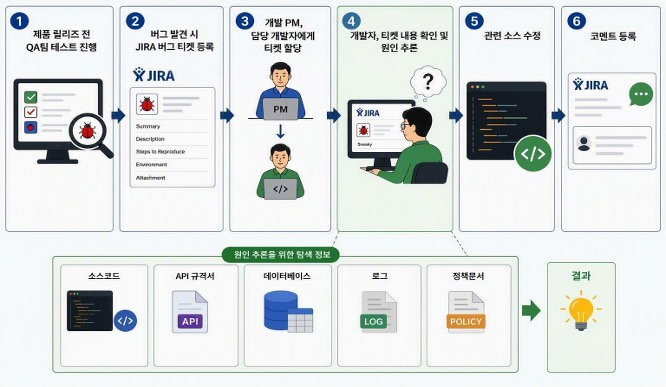
*일반적인 버그 처리 프로세스. 4단계 ‘원인 추론’에서 개발자는 여러 시스템을 오가야 합니다.*

여기서 눈여겨볼 곳은 4단계입니다. 원인을 찾는 데 필요한 정보가 한곳에 모여 있지 않거든요. 버그 유형에 따라 **소스 코드, API 규격서, 서버 로그, DB 데이터, 정책 문서, 과거 처리 이력**을 하나씩 찾아보며 퍼즐을 맞춰야 합니다.

코드를 고치는 시간보다, **고치기 전에 여기저기 흩어진 정보를 모으고 연결하는 시간**이 더 길 때가 많습니다. 그래서 이렇게 생각했습니다. 이 정보 수집과 연결을 AI Agent가 대신하고, 원인 분석까지 거들어 준다면 어떨까?

<a id="ai-agent가-들어갈-수-있는-네-개의-틈" style="display:block;scroll-margin-top:8rem"></a>

## AI Agent가 들어갈 수 있는 네 개의 틈

위 프로세스에서 반복적으로 발생하는 작업을 중심으로, Agent가 시간을 줄여줄 수 있는 네 가지 영역을 뽑았습니다.

| # | 영역 | 내용 | 상태 |
|---|---|---|---|
| 01 | **담당자 추천 · 자동 할당** | 티켓 내용, 관련 코드의 최근 커밋 이력, 유사 장애 처리 이력을 분석해 가장 적합한 개발자를 추천하고 할당합니다. | 다음 단계 |
| 02 | **원인 분석 자동화** | 코드·API 문서·DB·로그·정책 문서를 자동으로 검색하고, 서로 연관 지어 근거와 함께 원인을 제시합니다. | ✅ 구현 |
| 03 | **코드 수정안 생성** | 분석된 원인을 바탕으로 수정이 필요한 위치와 구체적인 수정안을 제안합니다. 반영은 개발자가 검토·승인한 뒤에만 이뤄집니다. | ✅ 구현 |
| 04 | **처리 결과 자동 기록** | 분석 내용, 원인, 수정 사항을 정리해 Jira 코멘트로 등록합니다. 정리 시간은 줄고, 처리 이력은 자연스럽게 지식 자산으로 쌓입니다. | ✅ 구현 |

핵심은 “AI야, 이 버그 분석해 줘”라고 던지는 게 아니라, **개발자가 반복하던 작업을 Agent가 단계별로 거들도록 만드는 것**입니다. 1번 담당자 추천은 다음 고도화 단계로 미뤄두고, 이번에는 2~4번에 집중했습니다.

<a id="다른-팀은-어떻게-하고-있을까" style="display:block;scroll-margin-top:8rem"></a>

## 다른 팀은 어떻게 하고 있을까

방향을 정하기 전에, 다른 기업과 개발자들이 AI Agent를 실무에 어떻게 적용하고 있는지 살펴봤습니다.

### Adriel — 글로벌 마케팅 BI 플랫폼

고객·운영 담당자가 Slack으로 문의하면 QA팀이 직접 답변하던 구조였는데, 분석해 보니 **이미 답한 적 있는 유사 이슈**가 상당수였습니다. 그래서 Slack에 쌓인 해결 사례를 벡터 DB(Qdrant)에 임베딩하고, Slack Bot 기반 Agent가 유사 사례를 먼저 찾아 답하도록 바꿨습니다. 사람은 필요할 때만 개입합니다.

- **흐름:** 버그/VOC → 과거 이슈 RAG 검색 → 유사 이슈·해결책 제공
- **기술:** RAG · Qdrant · Slack Bot

### 롯데쇼핑 — 대규모 이커머스 플랫폼

한밤중 결제 장애가 나면 알람만 울리고, 온콜 담당자가 수십 개 마이크로서비스의 로그를 직접 뒤져야 했습니다. 과거 장애 이력·배포 내역·운영 문서를 미리 벡터화해 두고, 알람이 오면 Agent가 로그와 과거 사례를 수집·분석해 **원인 후보 보고서와 Jira 티켓을 자동 발행**하도록 했습니다. 초기 정보 수집과 원인 분석 시간이 크게 줄었다고 합니다.

- **흐름:** 알람 → 로그·메트릭·배포 이력 → 과거 장애 검색 → RCA → Jira
- **기술:** Amazon Bedrock · 운영 데이터 · Knowledge Base

### Sam James — Magento 기반 웹서비스 개발자

QUBA의 목표와 가장 닮은 사례입니다. Agent가 Jira 버그를 분석하며 부족한 정보를 보강하고, 실제 환경을 띄워 버그를 재현합니다. 이후 로그와 코드를 분석해 수정 코드와 PR을 만들고, 담당자가 승인하면 배포까지 이어집니다. 버그 한 건당 평균 개발 비용을 **최대 80%**까지 줄였다고 소개합니다. 다만 공개 자료가 개념·아키텍처 수준이라 구체적인 구현은 확인하기 어려웠습니다.

- **흐름:** Jira → 정보 보강 → 자동 재현 → 로그/코드 분석 → 수정 PR → CI
- **기술:** LLM Agent · Docker · Playwright · Git/CI

<a id="사례에서-찾은-세-가지-설계-원칙" style="display:block;scroll-margin-top:8rem"></a>

## 사례에서 찾은 세 가지 설계 원칙

세 사례를 나란히 놓고 보니 공통된 원칙이 보였습니다. QUBA도 이 세 가지 위에서 설계했습니다.

### 1. 충분한 맥락(Context)을 줄 것

사용자 입력만으로 답하게 하면 LLM은 실제 시스템 상황이나 업무 규칙을 알 수 없고, 환각이 생기기 쉽습니다. 로그, Git 이력, 배포 정보, 유사 장애 사례 등을 미리 수집·색인해 두고 Agent가 필요할 때 꺼내 쓰는 **지식 기반 RAG**가 필요합니다.

### 2. LLM에게 손발(Tool)을 줄 것

LLM은 흔히 ‘방 안에 갇힌 천재’에 비유됩니다. 아무리 똑똑해도 Jira, 코드, DB, 로그에 닿지 못하면 일을 할 수 없죠. **판단과 추론은 LLM**이, **조회·재현·검증 같은 실행은 Tool**이 맡도록 역할을 나누고, MCP로 연결합니다.

### 3. 중요한 결정은 사람이(Human-in-the-Loop)

LLM은 같은 입력에도 같은 결과를 보장하지 않습니다. 실제 운영 환경에서 완전 자율 배포를 적용한 사례도 거의 없고요. 머지·배포·고객 답변처럼 영향도가 큰 단계에는 반드시 **승인 게이트**를 둡니다. AI의 역할은 ‘해결 완료’가 아니라, 개발자가 빠르게 판단할 수 있는 상태로 만들어 주는 것입니다.

> ✅ **결국 세 가지 질문입니다**
> 얼마나 좋은 Context를 줄 것인가, 어떤 Tool을 연결할 것인가, 어디까지 AI에게 맡기고 어디서 사람이 통제할 것인가. LLM 성능만큼이나 이 세 가지를 함께 설계하는 게 중요하다고 판단했습니다.

<a id="왜-langgraph였나" style="display:block;scroll-margin-top:8rem"></a>

## 왜 LangGraph였나

Agent를 구현할 프레임워크로 n8n, LangGraph, Claude Agent SDK 세 가지를 비교했습니다.

| | n8n | **LangGraph ✓** | Claude Agent SDK |
|---|---|---|---|
| **성격** | 시각적 연동 자동화 (로우코드) | **상태 기반 오케스트레이션** | Claude 중심 에이전트 실행 환경 |
| **잘하는 것** | SaaS·API 연결, 웹훅, 알림 자동화 | **조건 분기, 재시도, 멀티 에이전트, 승인 단계를 코드로 정교하게 제어** | MCP 도구 활용, 코드베이스 탐색과 분석·수정 |
| **장점** | 쉬운 연동, 비개발자 친화 UI, 빠른 PoC | **명시적 흐름 제어, 테스트·Git 친화, 모델 독립성, 장기 실행·상태 보존** | 도구 활용 극대화, 개발 업무를 빠르게 Agent화 |
| **단점** | 복잡한 상태 관리 어려움, 버전 관리·테스트 불편 | **높은 학습 곡선, 초기 설계 비용, 보일러플레이트** | Claude 종속성, 명시적 흐름 제어 약함 |

간단한 자동화라면 n8n이, 코드 분석·수정을 빠르게 Agent화하려면 Claude Agent SDK가 매력적입니다. 하지만 버그 처리는 일회성 작업이 아니라 **이슈 분석부터 처리까지 여러 단계를 거치는 긴 워크플로**입니다. 실행 흐름을 코드로 명확하게 통제하고, 앞으로 다양한 Tool을 붙여 확장하기에는 LangGraph가 가장 적합하다고 판단했습니다. 초기 학습 비용은 장기 운영을 위한 투자로 봤습니다.

<a id="quba-아키텍처-한눈에-보기" style="display:block;scroll-margin-top:8rem"></a>

## QUBA 아키텍처 한눈에 보기

이제 QUBA가 실제로 어떻게 생겼는지 보겠습니다.

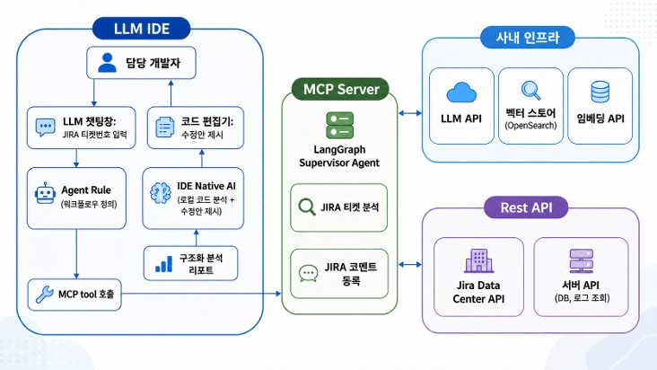
*QUBA 전체 구성과 흐름*

전체는 크게 네 영역으로 나뉩니다.

| 영역 | 역할 |
|---|---|
| **LLM IDE** | 개발자가 직접 사용하는 접점 |
| **MCP Server** | Agent의 두뇌. LangGraph Supervisor Agent가 전체 흐름을 관리 |
| **사내 인프라** | LLM API, OpenSearch 벡터 스토어, 임베딩 API |
| **REST API** | Jira Data Center API, 서버 API(DB·로그 조회) |

### ① LLM IDE — 개발자의 작업 공간에서 시작합니다

요즘은 코드 편집기에 LLM이 플러그인처럼 붙어 코딩을 돕는 게 자연스러운 흐름이죠. QUBA도 별도 화면을 만들지 않고 이 흐름에 올라탔습니다. 개발자가 IDE의 LLM 채팅창에 **Jira 티켓 번호만 입력**하면, 미리 정의한 버그 처리 Agent Rule에 따라 MCP Tool이 호출되고 MCP Server의 Agent가 분석을 시작합니다.

새로운 개발자가 QUBA를 쓰고 싶다면 준비물은 두 가지뿐입니다.

- QUBA 워크플로를 정의한 **마크다운 Rule 파일**을 로컬에 설치
- **MCP Server 연결 정보** 등록

### ② MCP Server — QUBA의 핵심

가운데의 MCP Server에는 LangGraph 기반 **Supervisor Agent**가 있습니다. 티켓이 들어오면 먼저 내용을 분석하고, 필요하면 관련 데이터와 코드를 조회한 뒤, 결과를 **구조화된 분석 리포트**로 만들어 IDE의 LLM에 전달합니다.

그다음은 IDE Native AI의 몫입니다. 리포트를 바탕으로 로컬 코드를 분석해 수정안을 작성하고, 개발자는 코드 편집기에서 수정 내용을 확인하고 승인한 뒤 반영합니다. 앞서 말한 **Human-in-the-Loop 원칙이 바로 이 지점**에 들어가 있습니다. 처리가 끝나면 Agent가 결과를 정리해 Jira 코멘트로 등록합니다.

### ③ 사내 인프라 — 맥락을 채워주는 곳

사내에 구축된 LLM API, OpenSearch 기반 벡터 스토어, 임베딩 API가 여기에 있습니다. 벡터 스토어 덕분에 Agent는 Jira 티켓 내용만 보는 게 아니라 **서비스 정책, API 명세, 코드 매핑** 같은 관련 정보까지 검색해 분석에 필요한 Context를 보강합니다.

> ⚠️ **사실 가장 손이 많이 가는 부분입니다**
> LLM은 일반 지식은 잘 알지만 사내 도메인, 정책, 화면 구성, 소스 코드는 전혀 모릅니다. 그래서 사내 데이터를 미리 벡터 DB에 임베딩해 LLM이 ‘오픈북’처럼 참고하게 하는 RAG가 필수인데, 실제로 이 작업이 Agent 개발보다 공수가 더 들었습니다. 데이터 구성과 검색 품질이 분석 결과를 직접 좌우하기 때문이죠. 이 부분은 3부에서 따로 자세히 다룹니다.

### ④ REST API — 실제 업무 시스템과의 연결

Jira Data Center API로 티켓을 조회하고 코멘트를 등록합니다. 별도 서버 API를 통해 DB나 로그 같은 사내 데이터도 조회할 수 있도록 설계했는데, 이 연결은 다음 고도화 단계에서 구현할 계획입니다.

<a id="7개-노드로-흐르는-파이프라인" style="display:block;scroll-margin-top:8rem"></a>

## 7개 노드로 흐르는 파이프라인

지금까지가 QUBA의 전체 지도였다면, 이제 그 안으로 한 단계 들어가 보겠습니다. 티켓 번호 하나가 들어와서 구조화된 분석 리포트가 나오기까지, MCP Server 안에서는 어떤 일이 벌어질까요?

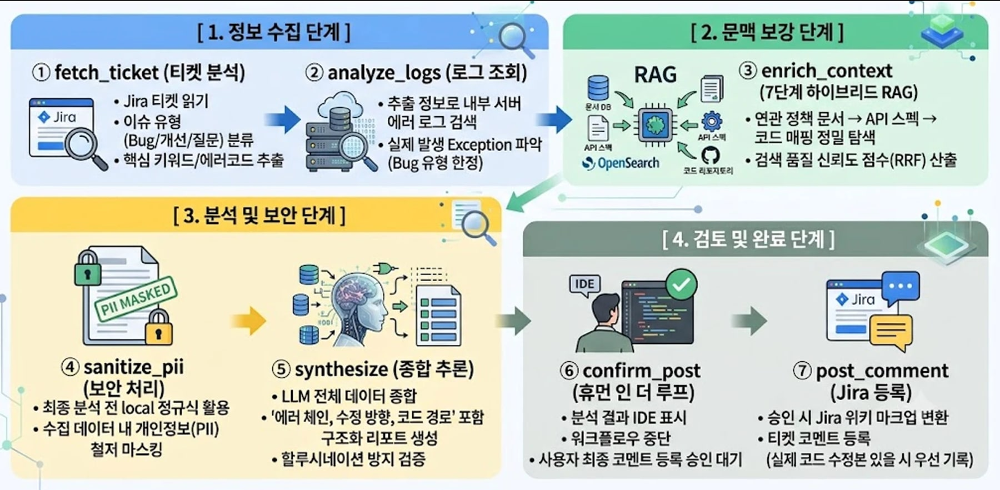
*QUBA의 7개 노드 파이프라인. 정보 수집 → 문맥 보강 → 분석 및 보안 → 검토 및 완료 네 구간으로 나뉩니다.*

MCP 내부는 **7개 노드**로 구성되어 있습니다. 전체 흐름을 간략하게 보면 다음과 같습니다.

| 노드 | 역할 |
|---|---|
| ① **fetch_ticket** | Jira에서 티켓을 가져와 **이슈 유형을 분류**하고, LLM으로 **검색 키워드를 추출** |
| ② **analyze_logs** | 버그 유형일 때 **에러 로그 조회** (현재는 로그 조회 API 미연동으로 생략) |
| ③ **enrich_context** | 정책 문서, API 스펙, Feature-Code 매핑을 검색하고 **검색 신뢰도 산출** |
| ④ **sanitize_pii** | 로컬 정규식으로 **개인정보 마스킹** |
| ⑤ **synthesize** | 모인 근거로 LLM이 **리포트를 생성**하고, 그 결과를 **코드로 검증** |
| ⑥ **confirm_post** | 사람이 리포트를 읽고 처리 방향과 **Jira 코멘트 등록 여부를 승인** |
| ⑦ **post_comment** | Jira에 **코멘트 등록** 후 마무리 |

⑥ confirm_post가 앞에서 이야기한 Human-in-the-Loop 승인 게이트입니다. 이 중 특히 중요한 **① fetch_ticket, ③ enrich_context, ⑤ synthesize** 세 노드를 좀 더 자세히 보겠습니다.

<a id="정보-수집--fetch_ticket" style="display:block;scroll-margin-top:8rem"></a>

## 정보 수집 — fetch_ticket

Jira 티켓을 보면 오류 현상에 대한 간단한 설명과 **재현 절차, 결과 정보**가 적혀 있습니다. QUBA는 이 자연어 정보를 가지고 정책 문서, API 스펙, 코드를 찾아갑니다.

가장 먼저 LLM이 **핵심 키워드 세 개**를 추출합니다. 예를 들어 선물 발신 후 구매내역 화면에 “수신대기 D-day” 문구가 잘못 노출되는 티켓이라면 **“선물 발신”, “수신 대기”, “D-Day”** 같은 키워드가 뽑힙니다.

처음에는 키워드를 5개에서 10개씩 뽑았습니다. 그런데 키워드가 많아질수록 **벡터 쿼리가 길어지고 변별력이 떨어졌습니다**. 여러 차례 테스트를 거쳐 결과가 가장 좋았던 **세 개**로 정했습니다.

이렇게 추출한 키워드 세 개에 **플랫폼 태그**(APP인지 모바일웹인지), **제목**, **에러 코드**를 붙여 검색에 사용할 **Search Query**를 구성합니다.

| 구성 요소 | 예시 |
|---|---|
| 키워드 3개 (LLM 추출) | 선물발신 / 수신대기 / D-Day |
| Platform Tag | APP&mWeb |
| Summary (제목) | 선물 발신 후 구매내역 컨텐츠 내 문구 … |
| Error Codes | AU001 |

<a id="문맥-보강--enrich_context" style="display:block;scroll-margin-top:8rem"></a>

## 문맥 보강 — enrich_context

enrich_context는 파이프라인에서 **가장 중요한 노드**로, 한마디로 **근거를 모으는 노드**입니다. LLM은 처음 검색 전략을 정할 때 **단 한 번만** 사용하고, 이후 7단계는 **검색과 계산만으로** 답을 도출합니다.

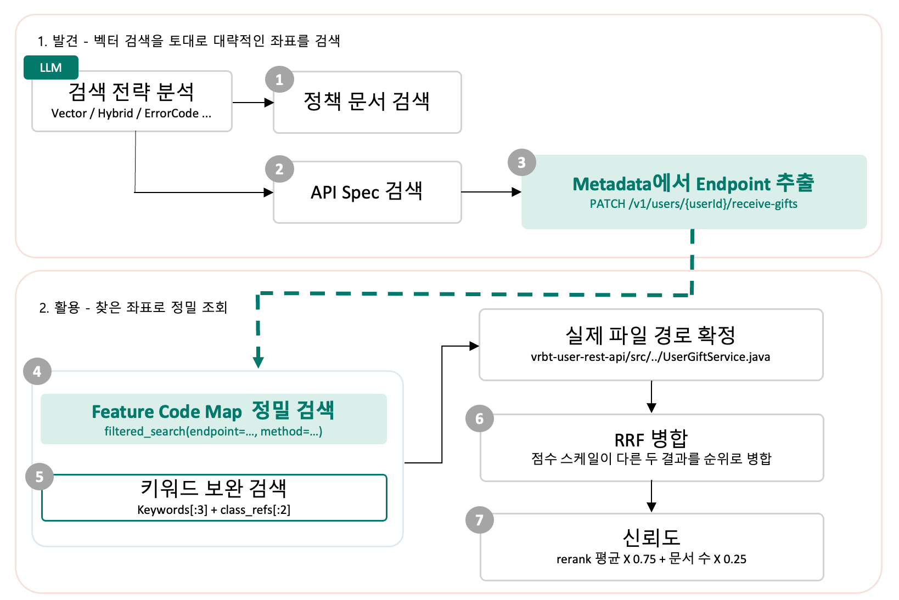
*enrich_context의 7단계. 벡터 검색으로 대략적인 좌표를 찾고(발견), 찾은 좌표로 정밀 조회합니다(활용).*

### 검색 전략 결정 (LLM 1회)

7단계를 시작하기 전, LLM이 쿼리를 읽고 API 문서를 어떤 방식으로 찾을지 정합니다.

| 전략 | 방식 | 유리한 경우 |
|---|---|---|
| **Vector** | 의미 기반 검색 | 일반 **자연어 쿼리** |
| **BM25** | 키워드/단어 기반 검색 | **에러 코드**처럼 딱 떨어지는 토큰이 있을 때 |
| **Hybrid** | Vector + BM25 | 둘 다 필요하거나, **BM25 결과가 0건**일 때 |

이를 규칙으로 짜면 **조건문이 끝도 없이 늘어나지만**, LLM이 쿼리를 읽으면 바로 결정할 수 있습니다. 왜 전략을 이렇게 나눠야 했는지는 3부에서 자세히 다룹니다.

### 7단계 검색 흐름

전략이 정해지면 본격적으로 7단계가 시작됩니다. 전체 흐름은 **발견 → 활용 → 정리** 세 구간으로 나뉩니다.

| 구간 | 단계 | 하는 일 | 핵심 포인트 |
|---|---|---|---|
| **발견** | 1. 정책 문서 검색 | “이게 **버그가 맞나**”를 판단할 근거 확보 | 정책과 일치하면 “의도된 동작” 리포트로 |
| | 2. API 스펙 검색 | 최대 **20개** → 리랭킹 → **5개** | BM25 0건이면 **하이브리드 재시도** |
| | 3. Endpoint 추출 | 검색된 메타데이터에서 엔드포인트 추출 | 티켓에 **없던 엔드포인트** 확보 |
| **활용** | 4. Feature-Code 매핑 정밀 검색 | **endpoint + method 일치** 필터 후 검색 | 엔드포인트 기준으로 코드 탐색 |
| | 5. 키워드 보완 검색 | 키워드 + 클래스명으로 **항상 함께** 검색 | 정확히 일치하는 결과가 없을 때 대비 |
| **정리** | 6. RRF 병합 | 점수 스케일이 다른 결과를 **순위 기준**으로 병합 | |
| | 7. 신뢰도 산출 | 모은 정보를 **얼마나 믿을 수 있는지** 계산 | 계산 방식은 3부에서 상술 |

4~5단계의 결과로 **실제 파일 경로**(예: `vrbt-user-rest-api/src/../UserGiftService.java`)를 확정합니다.

### 1단계 — 정책 문서 검색

정책 문서는 “이 코드가 어디 있나”에 대한 답이 아니라 “**이게 버그가 맞나**”를 판단하기 위한 정보입니다. 티켓 내용이 정책과 맞아떨어지면 오류로 보지 않고, 리포트를 “**정책상 의도된 동작이므로 코드 수정이 필요 없다**”는 방향으로 잡습니다.

### 2단계 — API 스펙 검색: 왜 하이브리드로 재시도할까?

문서를 **최대 20개** 뽑은 뒤, 리랭킹을 거쳐 **최종 5개**만 남깁니다. 여기서 핵심은 **하이브리드로 다시 검색한다**는 점입니다.

| 순서 | 상황 |
|---|---|
| ① | 쿼리는 “**선물 발신**”처럼 **한국어** |
| ② | API 스펙 문서는 REST Docs에서 뽑은 것이라 **영문** 위주 (예: `receive-gifts`) |
| ③ | 전략이 BM25이면 겹치는 토큰이 없어 **0건** |
| ④ | **하이브리드로 재시도** → 벡터 경로가 **의미로** 문서를 찾아냄 |

> ✅ **0건은 “없다”가 아니라 “문자열이 안 맞았다”입니다**
> BM25 0건은 문자열이 맞지 않았다는 뜻이지, 관련 문서가 없다는 뜻이 아닙니다. 하이브리드로 재시도하면 벡터 경로가 살아 있으므로 언어가 달라도 문서를 찾을 수 있습니다.

### 3단계 — Metadata에서 Endpoint 추출

API 문서 자체도 리포트에 쓰이지만, 더 중요한 것은 **티켓에 없던 엔드포인트**(예: `PATCH /v1/users/{userId}/receive-gifts`)를 여기서 얻는다는 점입니다.

### 4~5단계 — 코드 검색

3단계에서 얻은 엔드포인트를 기준으로 코드를 찾습니다. 벡터 검색만 돌리는 것이 아니라 **endpoint와 method가 정확히 일치하는 것만 걸러 놓고** 검색합니다. 정확히 일치하는 것이 없을 수도 있으므로, **키워드 보완 검색을 항상 함께** 수행합니다.

### 6~7단계 — 정리

각 검색 결과의 점수를 비교하기 위해 **RRF(Reciprocal Rank Fusion) 병합**을 수행하고, 마지막으로 이 정보들을 얼마나 믿을 수 있는지 **신뢰도**를 계산합니다.

엔드포인트를 왜 굳이 중간에 꺼내서 쓰는지, RRF로 순위를 병합하는 이유가 무엇인지, 신뢰도는 어떤 근거로 계산하는지는 모두 3부에서 다시 다루겠습니다.

<a id="분석과-검증--synthesize" style="display:block;scroll-margin-top:8rem"></a>

## 분석과 검증 — synthesize

synthesize 노드가 하는 일은 **LLM이 수정 대상을 뽑고, 그 결과를 코드로 검증**하는 것입니다. 흐름은 **입력 → JSON 생성 → 4단계 검증 → 분석 리포트** 순서입니다.

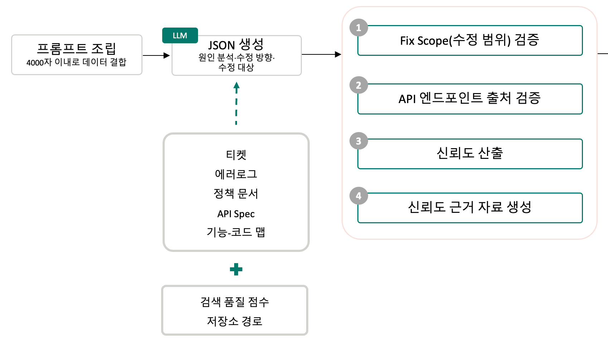
*synthesize 노드. LLM이 만든 JSON을 코드가 네 단계로 검증합니다.*

### 프롬프트 조립과 JSON 생성

먼저 enrich_context가 찾아온 정보들로 **4,000자 이내**의 프롬프트를 조립합니다.

| 구분 | 내용 |
|---|---|
| **입력 데이터 (5종)** | 티켓 / 에러 로그 / 정책 문서 / API Spec / Feature-Code 매핑 |
| **추가 입력** | 검색 품질 점수 / 저장소 경로 |
| **LLM 출력 (JSON)** | 원인 분석 / 수정 방향 / **수정 대상(Fix Scope)** |

LLM은 이 데이터를 종합하여 **Fix Scope, 즉 수정 범위**를 정합니다. 이렇게 나온 JSON은 다음 **4단계 검증**을 거칩니다.

### 4단계 검증

| 단계 | 검증 내용 | 목적 |
|---|---|---|
| 1. **Fix Scope 검증** | 수정 범위의 파일이 **실제로 존재하는지** 확인 | 없는 파일은 **삭제** |
| 2. **엔드포인트 출처 검증** | 엔드포인트가 **우리 데이터**에서 왔는지, **LLM이 만든 것**인지 표시 | **할루시네이션 방지** |
| 3. **신뢰도 산출** | “이 결론을 **믿어도 되는가**” 계산 | 가중 평균 |
| 4. **신뢰도 근거 자료 생성** | 신뢰도가 그 값인 **이유**를 자료로 생성 | 판단 근거 제공 |

**1단계 — 수정 범위(Fix Scope) 검증**

수정 범위에 포함된 파일에 대해 다음 네 가지를 **차례로** 확인합니다. 하나라도 통과하면 수정 범위에 남고, **하나도 해당하지 않으면 완전히 삭제**합니다.

| 순서 | 확인 조건 |
|---|---|
| ① | 경로가 **정확히 일치**하는가 |
| ② | **정규화**하면 일치하는가 |
| ③ | **같은 디렉토리**에 비슷한 파일이 있는가 |
| ④ | **유사도 0.75**를 넘는 파일이 있는가 |

**2단계 — API 엔드포인트 출처 검증**

리포트의 관련 API 정보에 있는 엔드포인트는 **수정 범위가 비었거나 보강 데이터가 필요할 때** 쓰이는 주요 데이터입니다. 그런데 가끔 **LLM이 엔드포인트를 지어내는** 경우가 있습니다. 그래서 할루시네이션을 방지하기 위해, 이 엔드포인트가 **우리 데이터에서 온 것인지 LLM이 만들어 낸 것인지 출처를 표시**해 둡니다.

**3~4단계 — 신뢰도 산출 및 근거 자료 생성**

QUBA에는 신뢰도가 두 번 등장합니다. 둘은 묻는 질문이 다릅니다.

| 구분 | enrich_context 신뢰도 | synthesize 신뢰도 |
|---|---|---|
| 질문 | **“검색이 잘 되었는가?”** | **“이 결론을 믿어도 되는가?”** |
| 계산 | 검색 품질 기반 (3부에서 상술) | 검색 품질과 LLM 판단의 가중 평균 |

신뢰도를 계산한 뒤에는 **그 근거를 자료로** 함께 만듭니다.

### 분석 리포트

이렇게 네 단계를 거치면 **버그 요약, 원인 분석, 수정 방향, 수정 범위, 신뢰도**를 담은 **분석 리포트**가 완성됩니다. 이 리포트가 **IDE로 돌아가서** 해당 티켓에 대한 후속 처리가 진행됩니다.

<a id="분석-근거는-어디서-오는가" style="display:block;scroll-margin-top:8rem"></a>

## 분석 근거는 어디서 오는가

여기까지가 QUBA가 어떻게 생겼고, 티켓 하나를 어떤 단계로 처리하는지에 대한 이야기였습니다. 이제 남은 질문은 하나입니다. **Agent는 그 근거를 대체 어디서 가져올까요?**

앞에서 설계 원칙 중 첫 번째로 꼽았던 ‘충분한 맥락(Context)을 줄 것’, 그리고 “Agent 개발보다 공수가 더 들었다”고 적어둔 그 작업이 바로 이 부분입니다. 원인을 찾는 데 필요한 정보가 한곳에 모여 있지 않다는 문제는 Agent에게도 똑같이 적용되거든요. LLM에게 질문을 던지는 것만으로는 부족했고, **관련 근거를 먼저 찾아낸 뒤 그 근거 안에서만 답하도록** 만들어야 했습니다.

2부에서 본 enrich_context의 7단계는 그 결과물입니다. 전략을 왜 Vector / BM25 / Hybrid로 나눴는지, 엔드포인트를 왜 중간에 꺼내는지, 신뢰도를 어떤 근거로 계산하는지 — 지금부터는 그 **설계 이유**를 하나씩 풀어보겠습니다.

막상 만들어보니, 검색 품질을 결정한 것은 임베딩 모델의 성능이 아니었습니다. 무엇을 하나의 벡터에 담을지, 벡터로 찾아낸 것을 무엇으로 이을지, 나온 점수를 어떻게 해석할지 — 이 세 가지 선택이 훨씬 큰 영향을 미쳤습니다.


*QUBA의 임베딩·검색 파이프라인*

문서를 청크로 나누고, 1024차원 벡터로 만들고, 후보를 넉넉히 확보한 뒤, 리랭커로 좁혀서 LLM에게 근거로 넘깁니다. 각 단계에서 무엇을 결정해야 했는지 순서대로 보겠습니다.

<a id="임베딩-의미를-좌표로-바꾸는-일" style="display:block;scroll-margin-top:8rem"></a>

## 임베딩: 의미를 좌표로 바꾸는 일

### 텍스트 하나에 좌표 하나

임베딩 모델이 하는 일 자체는 단순합니다. 텍스트를 **일정한 길이의 숫자 배열**로 바꿔주는 것입니다. QUBA에서 사용하는 모델은 사내에서 운영 중인 BGE-M3 계열 임베딩 모델로, 텍스트 하나를 1024개의 숫자로 표현합니다.

쉽게 말하면 텍스트마다 1024차원 공간 안에 좌표를 하나씩 찍어주는 셈입니다. 이 모델은 **문장 표현이 달라도 의미가 비슷하면 서로 가까운 좌표에 놓이도록** 학습되어 있습니다.

| 텍스트 | 벡터 | 관계 |
|---|---|---|
| “배너 등록이 실패한다” | `[ 0.12, −0.08, … ]` | 서로 가까움 |
| “콘텐츠 배너를 저장할 수 없다” | `[ 0.10, −0.06, … ]` | 서로 가까움 |
| “회원 탈퇴 정책” | `[ −0.31, 0.22, … ]` | 멀리 떨어짐 |

### 코사인 유사도로 비교한다

검색할 때는 Jira 질문도 **같은 모델로** 벡터를 만든 뒤, 문서 벡터와 코사인 유사도를 계산합니다. 코사인 유사도는 두 벡터 사이 각도의 코사인 값을 이용해, 두 벡터가 얼마나 같은 방향을 가리키는지 측정하는 지표입니다.

여기서 한 가지 짚고 넘어갈 점이 있습니다. 각 차원의 숫자가 무엇을 의미하는지 하나씩 해석하는 것이 아니라는 점입니다. 1024개 숫자 각각에 “이 차원은 긍정/부정을 나타낸다” 같은 해석 가능한 의미가 붙어 있지 않습니다. 우리가 사용하는 것은 **두 벡터가 가리키는 방향이 얼마나 비슷한가**, 그 관계 하나뿐입니다.

### 임베딩이 답해주지 않는 것

임베딩이 해주는 일은 “가까움을 계산 가능하게 만드는 것”까지입니다. **가까운 것이 실제로 정답인지는 임베딩이 답해주지 않습니다.** 이 구분이 왜 중요한지는 뒤에서 실측 데이터와 함께 다시 다루겠습니다.

> ℹ️ **같은 모델, 같은 차원이어야 합니다**
> 문서와 질문은 반드시 같은 모델, 같은 차원이어야 비교가 성립합니다. 모델이 바뀌면 좌표 체계 자체가 달라지므로, 차원 수가 우연히 같더라도 기존 벡터를 재사용할 수 없고 전량 재임베딩이 필요합니다.

<a id="임베딩-이전에-결정되는-것" style="display:block;scroll-margin-top:8rem"></a>

## 임베딩 이전에 결정되는 것

임베딩 모델을 고르기 전에 먼저 정해야 할 것이 있었습니다. **문서를 어디까지 하나의 덩어리로 볼 것인가**입니다.

문서 전체를 하나의 벡터로 만들면 여러 주제가 섞입니다. 그러면 어떤 질문과 비교해도 의미가 흐릿해져서, “이 문서는 뭐든 조금씩 관련 있어 보이는” 상태가 됩니다. 반대로 너무 잘게 나누면 이번에는 endpoint와 그 설명, 예외 코드 사이의 관계가 끊어져버립니다. 쪼개진 조각 하나만으로는 맥락을 알 수 없게 되는 것입니다.

### 청크 단위는 문서 종류마다 다르다

그래서 QUBA는 균일한 길이로 자르는 대신, **문서 종류마다 의미가 나뉘는 지점**을 기준으로 청크를 만듭니다.

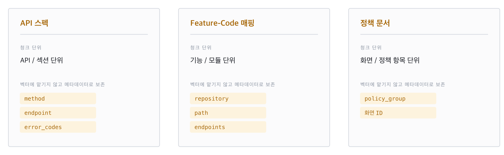
*소스별 청크 단위와 보존 메타데이터*

### 벡터에 맡기지 않는 값

위 그림에서 더 중요한 것은 오른쪽입니다. endpoint, 파일 경로, 에러 코드처럼 **정확히 같아야만 쓸모가 있는 값**은 벡터에 녹이지 않고 메타데이터로 따로 보존했습니다.

이유는 단순합니다. `/v1/banners`라는 문자열을 1024차원 벡터 안에 넣으면, 그 벡터는 “배너와 관련된 어떤 API”라는 흐릿한 의미를 갖게 됩니다. `/v1/banners`와 `/v1/banner-groups`는 벡터 공간에서 매우 가깝지만, 코드를 찾을 때는 완전히 다른 값입니다. 이런 값은 **유사도로 비교할 대상이 아니라 정확 일치로 걸러낼 대상**입니다.

2부에서 본 “3단계 Metadata에서 Endpoint 추출”이 가능했던 이유가 바로 이것입니다. 그때 꺼내 쓴 엔드포인트는 벡터 안에 녹아 있던 값이 아니라, 여기서 따로 보존해둔 값이었습니다.

<a id="청킹-실패가-임베딩-실패로-보였다" style="display:block;scroll-margin-top:8rem"></a>

## 청킹 실패가 임베딩 실패로 보였다

초기 인제스션 단계에서는 모델 품질보다 **데이터 파이프라인의 문제**가 먼저 드러났습니다. 검색 결과가 이상해서 임베딩 모델을 의심했는데, 실제 원인은 전혀 다른 곳에 있었습니다.

### v1 — 중복 청크 ID

첫 번째 문제는 중복된 청크 ID였습니다. 임베딩은 정상적으로 만들어졌습니다. 그런데 같은 ID를 사용한 문서들이 색인 과정에서 서로를 덮어썼습니다. 모델도, 벡터도 문제가 없었지만 **색인에 실제로 남은 문서는 전체의 69%뿐**이었습니다.

검색이 안 되는 이유를 모델 쪽에서 찾고 있었는데, 애초에 찾으려는 문서가 인덱스에 없었던 것입니다.

### v2 — 길이 제한

ID 문제를 해결하고 나니 이번에는 다른 벽이 나왔습니다. 4,000자를 넘는 입력이 임베딩 API에서 실패했습니다. 성공률은 96.7%까지 올라왔지만, 하필 실패하는 것들이 **가장 내용이 풍부한 긴 API 문서**였습니다.

### v3 — 섹션 경계 분할

여기서 긴 문서를 4,000자마다 기계적으로 자를 수도 있었습니다. 하지만 그렇게 하면 Request 설명과 Error Codes가 한 청크에 섞이거나, 반대로 하나의 설명이 두 조각으로 갈라집니다. 앞에서 이야기한 “청크 단위” 문제가 그대로 재현되는 것입니다.

그래서 **Request, Response, Error Codes 같은 섹션 경계를 우선**해서 나누고, 길이 제한은 그 다음에 적용되는 안전장치로 두었습니다. 그 결과 17,918자짜리 문서는 6개 청크로 나뉘었고, 대상 문서 346개 청크가 빠짐없이 색인됐습니다.

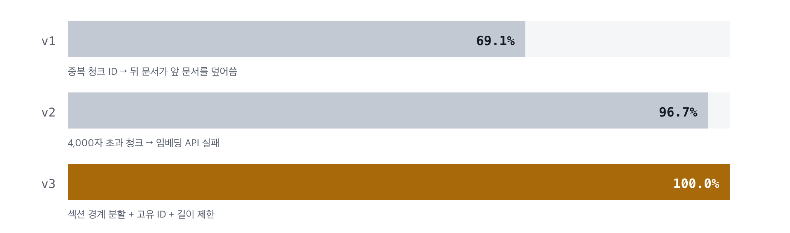
*API 스펙 인제스션 색인 성공률 개선*

### 여기서 얻은 것

한 가지 분명히 해둘 점은, 위 백분율이 **검색 정확도가 아니라 색인 성공률**이라는 것입니다. 69.1%가 “검색 정확도 69%”를 의미하지 않습니다.

다만 색인되지 않은 문서는 검색 정확도의 **상한**을 그대로 깎습니다. 인덱스에 없는 문서는 어떤 좋은 모델을 써도 찾을 수 없기 때문입니다.

> ✅ **모델보다 색인을 먼저 의심할 것**
> 검색 결과가 이상할 때 가장 먼저 확인해야 할 것은 모델 성능이 아니라, 찾으려는 문서가 애초에 인덱스에 들어가 있는지였습니다.

<a id="데이터-공급망을-분리하다" style="display:block;scroll-margin-top:8rem"></a>

## 데이터 공급망을 분리하다

이렇게 청크와 임베딩 데이터를 만드는 일은, 현재 `quba-data`라는 별도 프로젝트가 담당하고 있습니다.

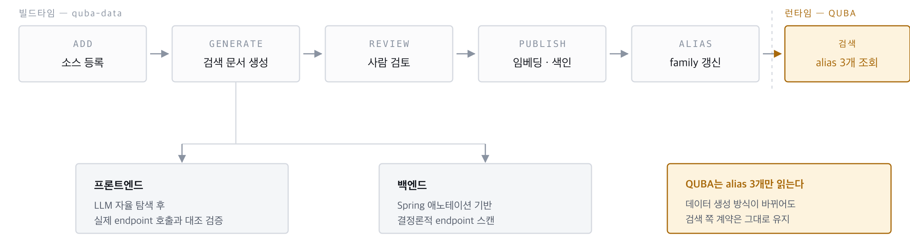
*quba-data 데이터 공급망*

먼저 원본 소스를 등록하고 검색용 YAML을 생성한 뒤, **사람이 내용을 최종 검토**합니다. 검토가 끝난 데이터를 publish하면 임베딩 생성과 OpenSearch 색인, alias 갱신까지 자동으로 이어집니다.

### 프론트엔드와 백엔드의 생성 전략이 다른 이유

검색 문서를 만드는 방식은 프론트엔드와 백엔드가 다릅니다. 같은 도구로 처리하려다 실패한 뒤 나눈 결과입니다.

| 구분 | 생성 방식 | 그렇게 한 이유 |
|---|---|---|
| **프론트엔드** | LLM이 코드베이스를 자율 탐색한 뒤, 생성 결과를 실제 endpoint 호출과 대조해 검증 | 하나의 기능에 대한 맥락이 페이지·컴포넌트·훅에 흩어져 있어 결정론적 스캔으로는 경계를 잡을 수 없습니다 |
| **백엔드** | Spring 애노테이션을 스캔해 method와 endpoint를 직접 추출 | 필요한 정보가 코드에 이미 선언되어 있습니다. LLM을 쓸 이유가 없고, 쓰면 오히려 환각 위험만 생깁니다 |

정리하면 **정보가 명시되어 있으면 코드로, 판단이 필요하면 LLM과 검증을 조합**하는 원칙입니다. 앞에서 이야기한 ‘판단은 LLM, 실행은 Tool’이라는 역할 분담이 데이터를 만드는 단계에서도 똑같이 적용된 셈입니다.

### 런타임과 빌드타임의 분리

이 구조에서 중요한 점은 QUBA가 데이터 생성 과정에 직접 관여하지 않는다는 것입니다. QUBA는 Feature-Code 매핑, API 스펙, 정책 문서 — **세 개의 alias만 읽습니다.** 물리 인덱스 이름조차 알지 못합니다.

덕분에 데이터를 만드는 방식을 나중에 개선하더라도 검색하는 쪽의 계약은 그대로 유지됩니다. 새 데이터를 publish하는 동안에도 런타임 검색은 영향을 받지 않습니다.

<a id="벡터는-어떻게-검색되는가" style="display:block;scroll-margin-top:8rem"></a>

## 벡터는 어떻게 검색되는가

이제 만들어진 벡터가 실제로 어떻게 검색되는지 보겠습니다. 문서 벡터는 OpenSearch의 `knn_vector` 필드에 저장되고, **HNSW**(Hierarchical Navigable Small World)라는 여러 층으로 된 이웃 그래프로 서로 연결됩니다.

### HNSW — 계층형 이웃 그래프

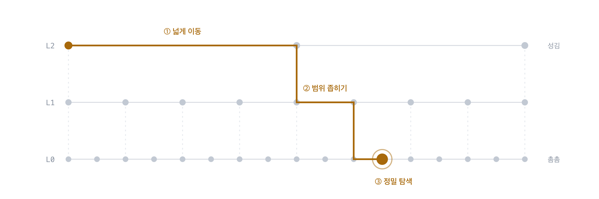
*HNSW 계층 탐색*

검색할 때는 노드가 적은 상위 계층에서 목적지 근처까지 크게 이동한 뒤, 노드가 촘촘한 하위 계층에서 가까운 벡터를 세밀하게 찾아 들어갑니다. 고속도로로 지역을 좁힌 다음 일반도로로 목적지를 찾는 것과 같은 방식입니다.

모든 문서를 하나씩 비교하는 대신 가까울 가능성이 높은 영역만 탐색하기 때문에 속도가 빠릅니다.

### 근사 검색이라는 전제

다만 이것은 **근사 검색(ANN)** 입니다. 전수 비교를 하지 않기 때문에 빠르지만, 실제로 가장 가까운 문서를 항상 찾는다는 보장이 없습니다.

이 전제가 이후 파이프라인 전체의 설계를 바꿨습니다. 1차 검색 단계에서 정답을 확정하려 하지 않고, 대신 후보를 **넉넉하게 확보**한 뒤 다음 단계에서 좁히는 2단계 구조를 택했습니다. 2부에서 본 “API 스펙 최대 20개 → 리랭킹 → 5개”가 바로 이 구조입니다. 이 단계의 목표는 정확도가 아니라 **누락하지 않는 것**입니다.

### 임베딩 장애 시 폴백

임베딩 API에 장애가 생기면 질문 벡터를 만들 수 없으므로 벡터 검색 자체가 불가능해집니다. 이때 조사를 중단하는 대신 **BM25 텍스트 검색으로 전환**합니다. 검색 품질은 떨어지지만 완전히 멈추는 것보다는 낫다는 판단입니다. 물론 이 전환이 일어났다는 사실은 로그로 관측하고 있습니다.

<a id="벡터-검색만으로-부족한-이유" style="display:block;scroll-margin-top:8rem"></a>

## 벡터 검색만으로 부족한 이유

그렇다면 모든 검색을 벡터로 처리하면 되지 않을까요? 그렇지 않았습니다.

임베딩은 표현이 다른 자연어를 연결하는 데 강합니다. “배너 등록이 안 된다”와 “콘텐츠 배너 저장 실패”를 이어주는 것은 임베딩이 가장 잘하는 일입니다. 하지만 모든 검색 문제에 적합한 것은 아니었습니다.

### 정확히 같아야 의미가 있는 값들

| 질문 속 신호 | 벡터 검색의 약점 | 보완 방식 |
|---|---|---|
| `UU304` | 의미 유사도보다 정확 일치가 중요합니다 | error code filter |
| `POST` | 짧고 일반적인 토큰이라 변별력이 없습니다 | method filter |
| `BannerController` | 고유 명칭이 그대로 보존되어야 합니다 | BM25 / hybrid |
| `/v1/banners` | 구조화된 식별자입니다 | endpoint filter |

에러 코드, HTTP method, 클래스명, endpoint는 **의미가 비슷한 값보다 정확히 같은 값이 중요**합니다. 그런데 이런 짧고 고유한 값은 임베딩 벡터 안에서 오히려 의미가 희석됩니다. `UU304`와 `UU305`는 벡터 공간에서 거의 같은 위치에 놓이지만, 실제로는 완전히 다른 에러입니다.

2부에서 전략을 Vector / BM25 / Hybrid로 나눠 LLM이 고르게 한 이유가 이것입니다. 질문에 따라 **잘 통하는 검색 방식이 다르기 때문**입니다. 벡터 검색을 포기한 것이 아니라, 의미 검색이 잘하는 일과 정확 일치 검색이 잘하는 일을 나눈 것입니다.

전략 판단이 실패하면 가장 넓은 `vector` 검색과 전체 저장소 조회로 폴백합니다. 여기까지의 목표는 정답을 확정하는 것이 아니라, **정답이 포함될 만한 후보를 충분히 모으는 것**이기 때문입니다.

<a id="후보-생성과-정밀-판정을-분리하다" style="display:block;scroll-margin-top:8rem"></a>

## 후보 생성과 정밀 판정을 분리하다

후보를 모았다고 해서 검색 점수가 높은 문서를 바로 정답으로 볼 수는 없었습니다.

### bi-encoder와 cross-encoder

임베딩 모델은 질문과 문서를 **각각 따로** 벡터로 만든 뒤 유사도를 비교합니다(bi-encoder). 문서 벡터를 미리 만들어둘 수 있어 대규모 후보를 빠르게 찾는 데 적합합니다.

반면 cross-encoder 리랭커는 질문과 후보 문서를 **한꺼번에 읽고** 둘의 관계를 판단합니다. 훨씬 정밀하지만, 문서마다 모델을 실행해야 하므로 비용이 큽니다. 전체 문서에 적용할 수는 없습니다.

그래서 역할을 나눴습니다. **임베딩으로 넓게 찾고, 리랭커로 좁힙니다.** 2부의 7단계 곳곳에 등장하는 “리랭킹”이 모두 이 cross-encoder입니다.

### 실측: 코사인은 정답과 오답을 구분하지 못했다

처음에는 검색 점수를 그대로 신뢰도로 사용할 생각이었습니다. 이 판단이 맞는지 확인하기 위해, **실제 버그 티켓 네 건**을 골라 정답 파일이 확정된 문서와 엉뚱하게 검색된 문서의 점수를 직접 측정했습니다.

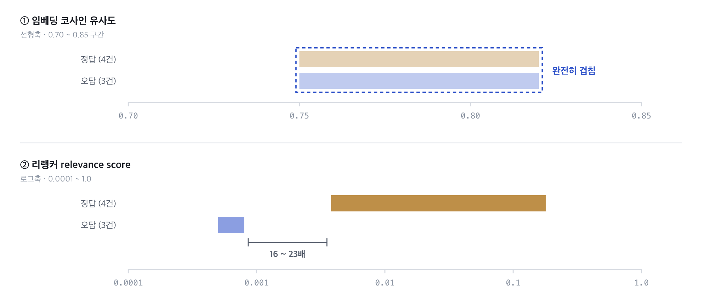
*같은 문서 집합에 대한 두 신호의 분리도 비교*

결과는 예상과 달랐습니다.

| 신호 | 정답 (4건) | 오답 (3건) | 관찰 |
|---|---:|---:|---|
| 임베딩 코사인 유사도 | 0.75 ~ 0.82 | 0.75 ~ 0.82 | **구분 불가** |
| 리랭커 relevance score | 0.0038 ~ 0.1798 | 0.0005 ~ 0.0008 | **16~23배 차이** |

**임베딩 코사인 유사도는 정답과 오답이 완전히 같은 구간에 있었습니다.** 임계값을 어디에 두더라도 둘을 가를 수 없습니다. 앞에서 “임베딩은 가까움만 계산해줄 뿐 정답인지는 답해주지 않는다”고 한 것이 이런 의미입니다.

반면 리랭커 점수는 정답과 오답 사이에 16배에서 23배까지 차이가 났습니다. **정답을 가르는 신호는 리랭커 쪽에 있었습니다.**

> ⚠️ **소규모 표본입니다**
> 정답 4건, 오답 3건으로 확인한 초기 결과입니다. 일반화된 정확도 지표로 볼 수는 없으며, 표본을 늘려 재확인할 계획입니다.

<a id="점수-분포를-이해해야-confidence가-된다" style="display:block;scroll-margin-top:8rem"></a>

## 점수 분포를 이해해야 confidence가 된다

신호가 리랭커에 있다는 것을 확인했으니, 이제 그 점수를 사용자에게 보여줄 **검색 신뢰도(confidence)** 로 바꿔야 했습니다. 2부의 7단계 마지막에 나온 “신뢰도 산출”이 이 계산입니다. 그런데 여기에 함정이 하나 더 있었습니다.

### raw score는 확률이 아니다

cross-encoder의 raw relevance score가 0.1이라고 해서 **정답일 확률이 10%라는 뜻이 아닙니다.** 위 표를 다시 보면 정답으로 확인된 문서조차 점수가 0.0038에서 시작합니다. 완전히 동일한 텍스트를 비교했을 때만 1에 가까운 값이 나오고, 그 외에는 대부분 0 근처에 몰리는 분포를 보입니다.

이 점수를 선형 0~1 스케일로 그대로 사용하면 어떻게 될까요? **정답 문서도 오답 문서도 전부 “0에 가까운 낮은 신뢰도”로 뭉개집니다.** 16배의 차이가 있어도 선형 스케일 위에서는 둘 다 바닥에 붙어 있기 때문입니다. 실제로 과거 버전에서 정답 문서의 confidence가 0.25로 계산되던 문제의 원인이 이것이었습니다.

### 로그 스케일 재보정

그래서 관찰된 정답과 오답의 분포를 기준으로 **0.0003 ~ 0.15 구간을 로그 스케일로 펼쳐서** 사용하기로 했습니다. 바닥값은 관찰된 오답의 최댓값보다 아래에, 천장값은 정답 분포의 상단 부근에 두었습니다. 이렇게 하면 0 근처에 몰려 있던 상대적 차이가 0~1 범위로 벌어집니다.

최종 신뢰도는 이렇게 계산합니다.

```
search_confidence = 재보정된 관련도 × 0.75  +  검색된 문서 수 × 0.25
```

관련도에 더 큰 비중을 두되, 근거 문서가 하나뿐인 경우와 여러 개인 경우를 구분하기 위해 문서 수도 함께 반영했습니다.

### 리랭커가 실패하면

리랭커 호출 자체가 실패하면 1차 검색 결과의 상위 문서를 그대로 사용합니다. 다만 이때 신뢰도 계산에는 주의가 필요합니다. vector 점수, BM25 점수, hybrid 점수는 **서로 스케일이 다르기 때문에** 그대로 신뢰도로 환산하면 의미 없는 값이 나옵니다.

그래서 이 경우에는 원점수를 섞지 않고 **중립값 0.5**를 사용합니다. “판단할 수 없다”는 상태를 억지로 숫자로 만들지 않기 위해서입니다.

> ⚠️ **확률이 아니라 운영 기준입니다**
> 이 계산 방식은 아직 작은 표본을 보고 정한 운영 기준입니다. 확률값이 아니라 “현재 데이터 기준으로 정한 값”으로 이해하는 것이 정확합니다.

<a id="벡터-위에-구조화된-연결을-더한다" style="display:block;scroll-margin-top:8rem"></a>

## 벡터 위에 구조화된 연결을 더한다

마지막 조각은 임베딩 검색 결과를 **실제 코드 후보로 연결하는 것**입니다.

자연어 질문으로 Feature-Code 매핑을 바로 벡터 검색하면 잘 맞지 않았습니다. “배너 등록 실패”라는 문장과 `BannerController`의 코드 요약문은 임베딩 공간에서 생각보다 멀리 떨어져 있습니다. 둘은 같은 것을 가리키지만 어휘 자체가 다른 세계에 속해 있기 때문입니다.

### endpoint를 인덱스 사이의 연결 키로

그래서 순서를 바꿨습니다. 먼저 자연어로 **API 스펙**을 검색합니다. API 문서에는 기능 설명이 자연어로 쓰여 있어서 임베딩이 잘 잡아냅니다. 그다음 검색 결과의 메타데이터에서 endpoint와 HTTP method를 추출합니다.

이 구조화된 값으로 Feature-Code 매핑을 **필터링**하면, 자연어를 한 번 더 비교하는 것보다 API와 코드의 관계를 훨씬 정확하게 연결할 수 있습니다. endpoint가 서로 다른 두 인덱스를 잇는 **연결 키** 역할을 하는 것입니다. 2부의 3~4단계가 이 설계를 그대로 구현한 것입니다.

### 독립 경로와 RRF

다만 이 연결이 단일 실패 지점이 되어서는 안 됩니다. API 문서를 찾지 못하면 코드 후보도 찾지 못하는 구조가 되기 때문입니다.

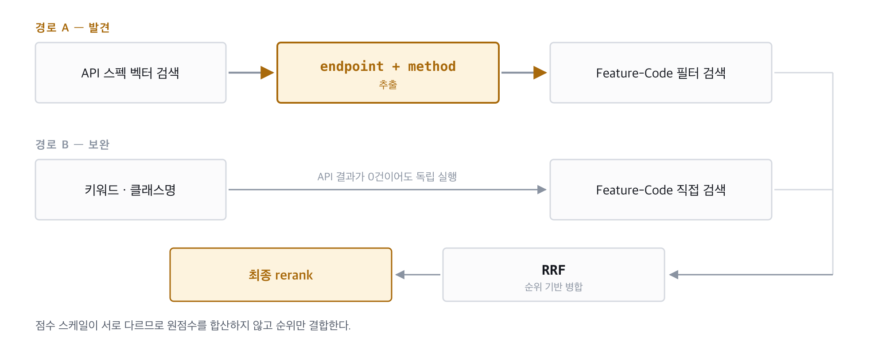
*경로 A(발견)와 경로 B(보완)는 서로 독립적으로 실행된다*

그래서 키워드와 클래스명으로 Feature-Code 매핑을 **직접 검색하는 경로를 항상 별도로** 실행합니다. 2부에서 “키워드 보완 검색을 항상 함께 수행한다”고 한 이유가 이것입니다. API 검색 결과가 0건이어도 코드 후보를 찾아가는 길은 남아 있습니다.

두 경로의 결과를 합칠 때는 또 다른 문제가 있습니다. endpoint 필터 검색과 키워드 벡터 검색은 **점수의 의미와 범위가 서로 다릅니다.** 이 값들을 그대로 더하면 스케일이 큰 쪽이 일방적으로 이깁니다.

그래서 절대 점수 대신 **순위만 사용하는 RRF**(Reciprocal Rank Fusion)로 병합합니다.

```
RRF(d) = Σ  1 / (k + rank(d) + 1)      # k = 60
```

각 결과 목록에서의 등수만 쓰기 때문에 별도의 점수 정규화 없이 공정하게 합칠 수 있습니다. 여러 경로에서 모두 상위에 올라온 문서가 자연스럽게 우선되고, 마지막으로 리랭커를 한 번 더 적용해 최종 근거를 정리합니다.

정리하면 역할이 이렇게 나뉩니다. **임베딩은 관련 API를 발견하고, endpoint는 그 API를 실제 코드와 정밀하게 연결합니다.**

### 임베딩 파이프라인을 한 장으로

여기까지가 Agent에게 근거를 공급하는 과정입니다. 단계별로 내린 결정을 정리하면 이렇습니다.

| 단계 | 핵심 결정 |
|---|---|
| **Chunk** | 문서 종류별 의미 경계로 분할하고, 정확 일치가 필요한 값은 메타데이터로 보존 |
| **Embed** | 문서와 질문을 동일 모델·동일 차원의 벡터 공간에 배치 |
| **Retrieve** | HNSW로 후보를 넓게 확보 — 정확도보다 누락 방지가 목표 |
| **Combine** | BM25·metadata filter·endpoint로 정확 일치 신호를 보강하고 RRF로 병합 |
| **Rerank & Trust** | cross-encoder로 정밀 판정하고, 점수 분포를 반영해 신뢰도 재보정 |

임베딩은 모델 API를 한 번 호출하고 끝나는 작업이 아니었습니다. 데이터 준비부터 검색 결과 평가까지 이어지는 파이프라인이었고, 품질을 좌우한 것은 모델 교체가 아니라 그 파이프라인 위의 선택들이었습니다.

<a id="비용과-시간으로-따져보기" style="display:block;scroll-margin-top:8rem"></a>

## 비용과 시간으로 따져보기

여기까지 보면 “**그래서 QUBA를 쓰는 게 이득일까?**”라는 궁금증이 생길 것입니다. 그래서 마지막으로 **비용과 시간** 측면에서 분석해 보았습니다.

### 측정 방법 및 결과

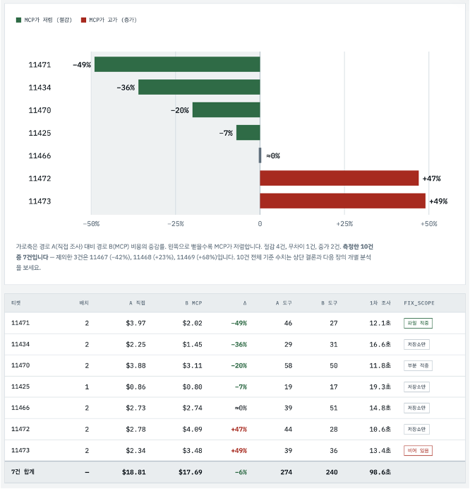
*티켓별 비용 증감률. 왼쪽으로 뻗을수록 QUBA 쪽이 저렴합니다.*

**8월 QA 티켓 7건**을 대상으로 정리하였습니다. 모델은 **Claude Opus 5**를 사용하였고, 티켓마다 두 경로를 각각 한 번씩 실행하였습니다.

- **A**: Jira MCP만을 통해 AI가 알아서 조사하는 경우
- **B**: QUBA가 조사해 준 리포트를 받아서 사용하는 경우

결과를 보면 합계 기준으로 **도구 호출은 12%, 비용은 6%** 줄었습니다. 참고로 이 7건 가운데 네 건은 앞서 리랭커 점수를 측정할 때 쓴 바로 그 티켓입니다.

### 예상과 달랐던 점

측정 전에 저희는 “MCP가 검색을 대신 해 주니까 AI가 코드를 덜 뒤질 것이고, 비용도 확실히 줄 것”이라고 예상하였습니다. 도구 호출 횟수는 실제로 **274회에서 240회로** 줄었습니다. 그런데 **비용은 그만큼 따라오지 않았습니다**.

QUBA 리포트가 “이 파일이다” 하고 짚어 주면, AI는 **그 파일을 통째로 엽니다**. 반면 직접 조사할 때는 **grep으로 먼저 범위를 좁히고 필요한 줄만** 뽑아 읽습니다. **읽어 들이는 데이터의 양**이 비용에 중요한 역할을 하므로, 위치를 정확히 알려 주는 것만으로는 부족했고 **얼마나 읽을지까지 좁혀 주어야** 했습니다.

저희는 그 원인을 **수정 범위에 담긴 데이터가 부족하기 때문**이라고 보았습니다. 실제로 비용이 증가한 케이스를 보면, **수정 범위가 비어 있거나 저장소만 특정된 경우**였습니다. 앞에서 본 Fix Scope 검증이 근거 없는 파일을 지우는 쪽으로 작동하다 보니, 근거가 얇으면 수정 범위가 통째로 비어 버리는 것입니다. 결국 **원천 데이터를 더 채워야 한다**는 결론으로 돌아옵니다.

### 시간 측면의 효과

그렇다면 지금 QUBA를 쓰는 것은 의미가 없을까요? 그렇지 않습니다. **시간 측면**도 함께 생각해 봐야 합니다.

QUBA가 티켓 하나를 처리하는 데에는 **평균 14.1초**가 걸립니다. 이 과정에서 **재현 경로, 기대 동작과 실제 동작, 관련 API 스펙, 정책 근거**까지 1차 조사를 모두 끝냅니다.

특히 저희 티켓들은 **description이 비어 있고, 재현 정보가 커스텀 필드에 흩어져** 있습니다. QUBA를 쓰면 이를 사람이 모아서 읽는 시간이 **통째로 사라지고**, 조사 결과도 그대로 IDE로 넘어갑니다. 개발자가 직접 Jira를 열고, 정책을 확인하고, 로그를 뒤지고, 코드를 찾는 단계가 빠지는 것입니다.

> ✅ **결론: 쓰는 쪽이 이득입니다**
> 티켓별로 편차는 있었지만 비용은 절감 쪽으로 기울었고, 1차 조사 시간은 확실히 줄어들었습니다.

<a id="마치며" style="display:block;scroll-margin-top:8rem"></a>

## 마치며

QUBA를 만들면서 가장 크게 느낀 건, 좋은 AI Agent는 좋은 모델 하나로 완성되지 않는다는 점입니다. **어떤 맥락을 주고, 어떤 도구를 쥐여주고, 어디서 사람이 멈춰 세울지**를 함께 설계해야 비로소 실무에서 쓸 만한 Agent가 됩니다.

같은 이야기가 한 단계 안쪽에서도 반복됐습니다. 검색 품질 역시 임베딩 모델 하나가 결정하지 않았거든요. 무엇을 벡터에 담을지, 찾아낸 것을 무엇으로 이을지, 나온 점수를 어떻게 해석할지를 설계하는 일이 모델 선택보다 훨씬 큰 차이를 만들었습니다. 비용 측정에서 얻은 결론도 결국 같은 방향이었습니다. 더 똑똑한 모델이 아니라 **더 나은 근거**가 필요했습니다.

솔직하게 말씀드리면, 지금 적용 중인 값들은 대부분 **현재 데이터에 맞춰 잡아둔 잠정값**입니다. 청크 크기도, 후보 폭도, 신뢰도 재보정 구간도 최적값이라는 근거가 아직 충분하지 않습니다. 그래서 다음에 필요한 것은 더 복잡한 알고리즘이 아니라 **평가 데이터**라고 보고 있습니다. golden set을 기준으로 청킹 방식과 검색 전략, 신뢰도가 실제로 함께 좋아지는지 측정할 수 있어야, 지금의 기준들을 근거를 가지고 바꿀 수 있기 때문입니다.

앞으로는 **FE UID 임베딩**과 **LOG MCP**, **DB MCP**로 원천 데이터를 보강해 수정 범위를 더 풍부하게 만들 계획입니다. 담당자 자동 추천도 아직 남아 있는 숙제고요.

아직 갈 길이 남았지만, 버그 티켓 번호 하나로 원인 분석 리포트와 수정안을 받아보는 경험은 꽤 인상적이었습니다. 비슷한 고민을 하는 분들께 작은 참고가 되면 좋겠습니다. 읽어 주셔서 감사합니다.

---

*이 글은 2026년 9월 21일 사내 AI & Tech Talk(ATT) 발표 내용을 바탕으로 작성했습니다. · VAS개발팀 이학성, 하동우, 민경윤*
