대규모 데이터 인프라 환경에서 안정적이고 빠른 데이터 입수는 하위 분석 작업과 비즈니스 의사결정의 중요한 초석이라고 생각합니다. 기존 인프라에서는 1,200여 개의 데이터 파이프라인이 Oozie XML을 통해 관리되고, 데이터 입수 도구로 Sqoop이 사용되고 있었습니다.

해당 시스템은 오랜 기간 제 역할을 수행해 주었으나, 장기적인 관점에서 더 이상의 성능 향상을 기대하기 어려운 구조적 아쉬움이 있었습니다.
해당 글에서는 기존 파이프라인의 기술 부채를 해소하고, 데이터 입수 속도 개선과 HDFS 파일 사이즈 최적화 및 쿼리 성능 극대화를 달성하기 위해 Airflow와 Spark를 도입한 경험을 공유합니다.

---

# 1. 프로젝트 추진 배경: 정체된 레거시 기술 부채 해소

1,200여 개에 달하는 거대한 데이터 파이프라인을 전면 개편하는 것은 적지 않은 리소스가 투입되는 작업입니다. 당장 시스템에 치명적인 장애가 발생하고 있는 상황은 아니지만, 지속 가능한 데이터 인프라 운영을 위해 다음과 같은 세 가지 측면에서 근본적인 아키텍처 개편이 불가피했습니다.

- **기술 부채 해소 및 아키텍처 모던화**: 데이터 입수를 담당하던 Apache Sqoop은 2021년에 공식 지원이 종료(Attic)된 프로젝트입니다. 당장의 파이프라인 동작에는 문제가 없었으나, 프레임워크 차원의 성능 개선이나 최신 데이터 생태계와의 호환성 확장을 더 이상 기대할 수 없는 상태였습니다. 누적되는 기술 부채를 정리하고 향후 확장을 대비하기 위한 모던 스택으로의 전환이 필요했습니다.
- **운영 효율성 및 DX(Developer Experience) 개선**: 기존 Oozie 기반의 환경은 직관적이지 않은 Web UI로 인해 모니터링과 트러블슈팅에 불편함이 있었습니다. 또한, 1,200여 개의 파이프라인을 XML로 개별 하드코딩하여 관리하는 방식은 단순 변경 사항 반영 시에도 일일이 수정해 줘야 하는 불필요한 운영 리소스를 소모하게 했습니다. 이를 Python 기반의 동적 제어가 가능한 Airflow로 교체하여 개발자 경험과 관리 편의성을 높이고자 했습니다.
- **포맷의 한계와 성능 정체 극복**: 기존 데이터 포맷(Text+Gzip)은 분할(Split) 처리가 불가하여 하위 분석 쿼리의 응답 시간을 단축하는 데 제약이 있었습니다. 또한 Sqoop의 고정 Mapper 할당 방식은 HDFS에 불필요한 Small File을 양산하는 구조였습니다. 이를 근본적으로 해결하기 위해 파티션 제어가 유연한 분산 처리 엔진(Spark)과 컬럼 기반 조회 성능에 최적화된 데이터 포맷(Parquet+Snappy)의 도입을 추진하였습니다.

---

# 2. 시스템 아키텍처: YAML 기반 DAG 동적 배포

운영 효율을 극대화하기 위해 Python 코드로 워크플로우를 동적 제어할 수 있는 **Airflow**를 도입하고, 데이터 처리 엔진을 **Spark**로 전환했습니다. 

단순히 도구를 교체하는 것을 넘어, 파이프라인 생성 과정을 템플릿화하는 아키텍처를 설계했습니다. **Airflow Dag Factory** 패턴을 도입하여 실행 로직과 설정값을 분리하고, **공통 설정(`base.yaml`)**과 **개별 파이프라인 설정(`dag.yaml`)**을 조합하여 동적으로 DAG가 배포되도록 구축했습니다.

이 아키텍처를 통해 `Spark 데이터 입수 ➔ Hive Table/Partition 생성 및 암호화 ➔ 완료 마커 생성(.done)`으로 이어지는 일관된 워크플로우를 중앙에서 제어할 수 있게 되었습니다.

## 2.1. 메타데이터의 이원화 (공통 설정과 개별 설정의 분리)

기존 시스템에서는 1,200여 개의 파이프라인이 각각의 XML 파일로 하드코딩되어 있어, 공통 속성 하나를 변경하더라도 엄청난 반복 작업이 수반되었습니다. 이를 해결하기 위해 파이프라인 메타데이터를 두 가지 계층으로 분리하여 관리하는 구조를 도입했습니다.

전체 파이프라인에 공통으로 적용되는 Spark 리소스 설정, 재시도 횟수, 알림 설정 등은 `base.yaml`로 중앙화하고, 개별 파이프라인이 가져야 하는 고유 정보(원천 DB URL, 스키마, 파티션 조건 등)는 각각의 `dag.yaml`에 정의하도록 규격화했습니다.

### 공통 템플릿 (`base.yaml`)
모든 파이프라인에 일괄 적용되는 기본 설정입니다.
```yaml
BASE:
  default_args:
    owner: "<svc_account>"
    retries: 2
    retry_delay_minutes: 5
  spark_defaults:
    queue: "<yarn_queue>"
    version: "3.5.6"
```

### 개별 파이프라인 설정 (`dag.yaml`)
파이프라인별 고유 속성과 스키마 정보가 담긴 메타데이터입니다.
```yaml
hiveDb: "<hive_db>"
hiveTable: "<hive_table>"
sourceType: "oracle"
startDate: "2026-08-28"
cronExpression: "0 4 * * *"
basePath: "hdfs://<name_node>/data/<hive_db>/raw/<hive_table>"
partitionBy: "part_date"
isHourly: false
isProd: true
nullSupport: true
executor: 2
jdbcUrl: "jdbc:oracle:thin:@//<host>:<port>/<service_name>"
jdbcUser: "<db_user>"
pwdPath: "hdfs://<name_node>/user/<svc_account>/credential/<password_file>"
dbName: "<db_name>"
tableName: "<SOURCE_TABLE>"
columns:
  - name: "COL_A"
    type: "string"
    encrypt: false
  - name: "COL_B"
    type: "string"
    encrypt: false
```

## 2.2. Factory 패턴을 통한 파이프라인 자동 조립

Airflow 스케줄러가 로드될 때, `factory.py`에 구현된 `create_dag` 함수가 위 두 개의 메타데이터를 파싱합니다. 조합된 설정값을 바탕으로 파이프라인을 구성하는 3개의 핵심 Task가 자동으로 인스턴스화되고 체이닝됩니다.

개별 `dag.yaml`만 작성하면 즉시 파이프라인이 Airflow DAG로 배포됩니다.

```python
# factory.py 내 동적 DAG 생성 로직
def create_dag(conf):
    # 1. 메타데이터 파싱 및 방어 로직 검증
    dag_id = conf.get('dag_id')
    if not conf.get('sourceType'):
        raise ValueError(f"sourceType is missing for DAG: {dag_id}")

    with DAG(dag_id=dag_id, default_args=default_args, ...) as dag:
        # 2. Spark 데이터 입수 Task
        import_task = DI_SparkOperator(**spark_kwargs)

        # 3. Hive Task
        create_and_update_hive_task = QcOperator(
            task_id="create_and_update_hive_task",
            sql=hive_sql
        )

        # 4. HDFS 완료 마커 생성 Task
        create_done_file = TemplatedQcHdfsFsOperator(
            task_id="create_done_file",
            fs_command=f"fs -touchz '{custom_part_path}/.done'"
        )

        import_task >> create_and_update_hive_task >> create_done_file

    return dag
```

## 2.3. 커스텀 Operator 활용 및 콜백(Callback) 기반 모니터링

파이프라인은 사내 환경에 맞게 생성된 커스텀 Operator(`DI_SparkOperator`, `QcOperator`)를 래핑하여 사용했습니다. 이를 통해 Spark Submit 파라미터 구성과 Hive 쿼리 실행 제어를 규격화했습니다.

또한, Factory 패턴 내에 `on_failure_callback`과 `on_success_callback`을 주입했습니다. 이를 통해 DAG가 실패했을 때 사내 메신저(Teams) 및 이메일 알림이 즉시 발송되고, 정상 수행됐을 시에는 Metric이 수집되는 모니터링 체계를 확보했습니다.

---

# 3. 핵심 로직: 어떻게 잘 가져올 것인가

데이터 파이프라인 고도화 과정에서 가장 신경 쓴 부분은 '단일/병렬처리 동적 분기 및 최적 파티션 키 선정을 통한 입수 속도 개선'입니다. 

기존 Sqoop은 기본 설정만으로 테이블 규모나 특성을 크게 신경 쓰지 않고 데이터를 입수할 수 있다는 편의성이 있었습니다. 하지만 Sqoop은 Mapper 수가 곧 DB 동시 커넥션 수로 직결되는 구조라, 실제로 입수 소요 시간을 단축하기 위해 Mapper 수를 상향 조정했다가 DB Connector Pool 고갈로 장애가 발생한 이력이 있었습니다. 이후로는 개별 테이블의 크기, 스키마, 인덱스를 일일이 확인하며 안전한 수준까지만 수동으로 조정해야 했는데, 1,200여 개에 달하는 테이블 각각에 대해 이런 검증을 반복하는 것은 대규모 파이프라인 환경에서 현실적으로 비효율적이었습니다.

그래서 Oggre는 테이블의 특성을 런타임에 직접 파악하고, 그에 맞는 추출 전략을 스스로 선택하도록 설계했습니다. 전체 입수 흐름은 다음과 같으며, 이후 절에서 각 단계를 순서대로 살펴보겠습니다.
(Oggre는 AI Data Platform팀의 RDBMS 데이터 입수 프레임워크입니다.)

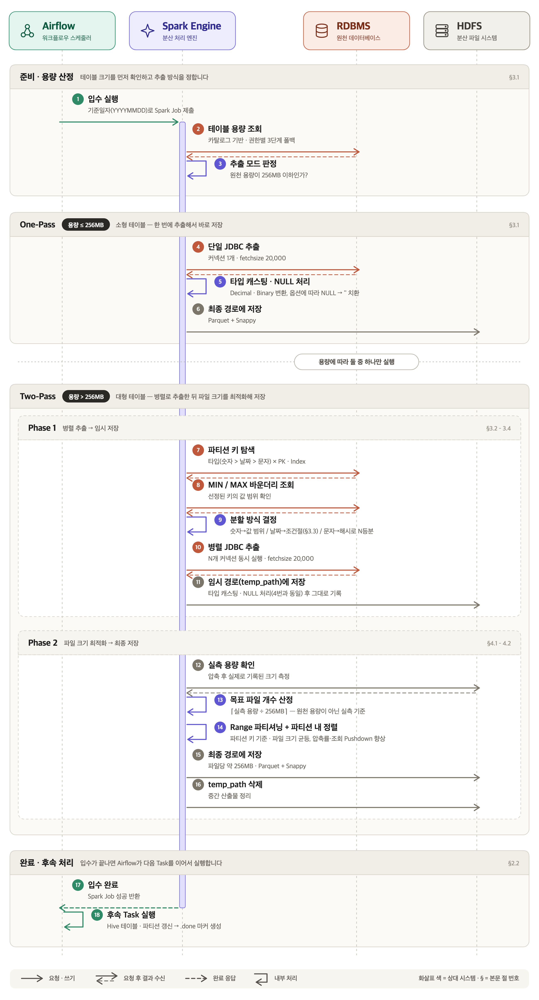

## 3.1. 용량 산정 및 단일/병렬 추출 모드 분기

가장 먼저 수행되는 작업은 대상 테이블의 크기를 파악하는 것입니다. 권한 문제나 메타데이터 누락 상황에 대비하여, 3단계 구조로 테이블 용량을 계산합니다.

1. **DBA_SEGMENTS**: 관리자 뷰에서 물리적 세그먼트 크기 조회
2. **USER_SEGMENTS**: DBA 권한이 없을 경우 사용자 뷰로 폴백
3. **ALL_TABLES**: 디스크 할당량이 0MB로 식별될 경우 논리적 통계(`NUM_ROWS * AVG_ROW_LEN`) 활용

계산된 용량을 바탕으로 **256MB**를 분기점으로 삼아 추출 모드를 결정합니다. 256MB 이하의 소형 테이블은 단일 커넥션으로 오버헤드 없이 추출하는 `[One-Pass]` 모드로 동작하며, 이를 초과하는 테이블은 파티셔닝 기반의 병렬 추출인 `[Two-Pass]` 모드로 입수됩니다.

### 동시 DB 커넥션 제어

추출 모드는 원천 DB에 여는 커넥션 수와도 직결됩니다. `[One-Pass]` 모드는 커넥션 1개만 사용하고, `[Two-Pass]` 모드는 테이블을 여러 구간으로 나눈 뒤 구간마다 커넥션을 엽니다.

여기서 Sqoop과 결정적으로 달라지는 부분이 있습니다. Sqoop은 데이터를 나누는 단위(Mapper)가 곧 동시에 실행되는 단위여서, 병렬성을 높이면 동시 커넥션 수도 그대로 늘어났습니다. 반면 Spark는 데이터를 나누는 단위(파티션)와 동시에 실행되는 단위(태스크 슬롯)가 분리되어 있습니다. 파티션을 몇 개로 나누든 동시에 실행되는 태스크는 **Executor 수 × Executor당 코어 수**를 넘지 않으므로, 원천 DB에 동시에 열리는 커넥션도 이 값으로 상한이 고정됩니다. 현재 스펙(Executor 2개 × 코어 4개, 3.4 참고)에서는 파이프라인 하나당 최대 8개이며, 나머지 파티션은 앞선 태스크가 끝나 커넥션을 반납한 뒤 순서대로 실행됩니다.

덕분에 테이블마다 크기와 인덱스를 확인하며 안전한 병렬 수를 따로 계산하지 않아도, 모든 테이블에 대해 원천 DB 부하의 상한을 미리 알 수 있게 되었습니다. 원천 DB 사정에 따라 동시 커넥션을 조정해야 하는 테이블은 개별 `dag.yaml`의 `executor` 값만 바꾸면 됩니다.

## 3.2. 병렬 처리 효율을 가르는 최적 파티션 키 자동 탐색

병렬 추출(`[Two-Pass]`) 모드에서 데이터를 균등하게 나누어 가져오기 위한 파티션 키(partitionColumn) 선정은 속도 개선의 핵심입니다. DB 카탈로그(`ALL_TAB_COLUMNS`, `ALL_CONSTRAINTS` 등)를 조회하여 다음 기준에 따라 우선순위를 매기고 동적으로 최적의 키를 선정합니다.

*   **1순위**: 숫자형(INT/NUMBER)이면서 PK 또는 Index에 포함된 컬럼
*   **2순위**: 날짜형(DATE/TIMESTAMP)이면서 PK 또는 Index에 포함된 컬럼
*   **3순위**: 인덱스가 없는 숫자/날짜형 컬럼
*   **4순위**: 문자형(CHAR) 및 기타 컬럼

단순히 컬럼을 지정하는 것을 넘어, 데이터 타입과 인덱스 유무를 종합적으로 판단하여 병렬 처리 시 발생할 수 있는 데이터 스큐(Data Skew) 현상을 줄이고자 하였습니다.

## 3.3. Date/Timestamp 타입 불일치 에러 방지

파티션 키가 숫자형일 경우에는 Spark의 기본 옵션(`partitionColumn`, `lowerBound`, `upperBound`)을 사용해도 무방합니다. 하지만 Date/Timestamp 타입의 경우 파라미터 바인딩 과정에서 타입 이슈가 발생할 수 있습니다.

Oggre는 하드코딩된 날짜를 사용하지 않고, 런타임에 원천 DB에서 Min/Max 값을 조회하여 동적인 파라미터로 바운더리를 할당합니다. 이때 조회된 날짜 값을 Spark의 기본 옵션에 그대로 주입하면, Spark가 내부적으로 형변환(Type Casting)을 거쳐 JDBC Statement 파라미터로 바인딩합니다. 이 과정에서 원천 DB의 드라이버가 Spark의 내부 날짜 객체를 정확히 인식하지 못해 **타입 불일치(Type Mismatch) 에러를 발생시키며 파이프라인이 실패**하는 현상이 있었습니다.

이러한 동적 변수 할당 시 발생하는 형변환 이슈를 차단하기 위해, 날짜형 컬럼은 `partitionColumn` 옵션을 배제하고 **Spark의 Predicates API**를 활용하여 명시적인 조건절을 직접 주입하는 방식을 채택했습니다.

```python
# 1. 날짜형(Date) 컬럼의 Min/Max 바운더리를 문자열 형태로 사전 조회
# (MIN, MAX를 동시에 조회하면 인덱스의 이점을 누리지 못할 수 있습니다. 서브쿼리로 분리를 추천합니다)
bounds_sql = f"""(
    SELECT 
        (SELECT TO_CHAR(MIN({target_col}), 'YYYY-MM-DD HH24:MI:SS') FROM {self.table_name}) AS MIN_DT, 
        (SELECT TO_CHAR(MAX({target_col}), 'YYYY-MM-DD HH24:MI:SS') FROM {self.table_name}) AS MAX_DT 
    FROM DUAL
) tmp"""

# 2. Spark 내부 형변환을 우회하기 위한 명시적 조건절(Predicates) 배열 동적 생성
# (+1초: 마지막 구간의 상한이 MAX 값보다 커지도록 해 MAX 값 행이 누락되지 않게 합니다)
step = max(1, math.ceil((max_ts - min_ts + 1) / read_parts))
predicates = [
    f"{target_col} IS NOT NULL AND "
    f"{target_col} >= TO_DATE('{datetime.fromtimestamp(min_ts + i*step).strftime('%Y-%m-%d %H:%M:%S')}', 'YYYY-MM-DD HH24:MI:SS') AND "
    f"{target_col} < TO_DATE('{datetime.fromtimestamp(min_ts + (i+1)*step).strftime('%Y-%m-%d %H:%M:%S')}', 'YYYY-MM-DD HH24:MI:SS')"
    for i in range(read_parts)
]

# NULL은 어떤 범위 조건에도 걸리지 않으므로 별도 파티션으로 수집합니다
predicates.append(f"{target_col} IS NULL")

# 3. Predicates API를 활용한 안전한 병렬 추출
df_main = self.spark.read.jdbc(
    url=self.jdbc_url,
    table=dbtable_main,
    predicates=predicates,
    properties={ "fetchsize": "20000", ... }
)
```

즉, Spark가 파라미터를 추론하여 형변환하도록 두지 않고, 사전에 파싱한 Min/Max 값을 바탕으로 원천 DB가 명확히 이해할 수 있는 조건절 문자열(예: `TO_DATE` 구문)을 직접 생성하여 전달합니다.
이를 통해 RDBMS와 타입 충돌 없이 동적인 파티셔닝과 병렬 추출이 가능해졌습니다.

## 3.4. Spark 메모리 제어: Phase 1과 Phase 2로 나누어 살펴보기

1,200여 개의 테이블은 컬럼 수, 데이터 타입, 레코드 크기가 모두 다른 이기종 환경입니다. 어떤 테이블이 들어오더라도 OOM 없이 안정적으로 동작하는 리소스 기준점을 잡는 것이 핵심 포인트였습니다.

현재 Oggre의 핵심 Spark 리소스 스펙은 다음과 같습니다.

- Executor 2개
- Cores per Executor 4개
- Executor Memory 10GB (+ Memory Overhead 2GB)
- spark.memory.fraction: 0.8
- JDBC fetchsize: 20,000

Memory Overhead 2GB는 JVM 힙 밖의 native 메모리(스레드 스택, 네트워크 버퍼 등)로, 아래 계산에서는 제외합니다. Spark는 executor-memory에서 고정 예약 영역(300MB)을 제외한 나머지(약 9,940MB)를 spark.memory.fraction 비율로 나눕니다.

Execution Memory(약 7,952MB, 80%): 셔플·정렬 등 Spark 연산이 사용하는 영역으로, Spark의 MemoryManager가 태스크별 사용량을 실제로 추적해 할당량을 넘으면 디스크로 spill시킵니다. 정확히는 캐시용 Storage Memory와 함께 쓰는 공용 영역이지만, Oggre는 캐시를 사용하지 않아 사실상 Execution이 전부 사용합니다.
User Memory(약 1,988MB, 20%): JDBC ResultSet, Parquet Writer 버퍼 등 Spark의 관리 밖에 있는 일반 JVM 객체가 사용하는 영역입니다. 4개 코어가 동시에 태스크를 수행하므로, 태스크당 평균 약 497MB(1,988MB ÷ 4)를 쓸 수 있는 셈입니다.

여기서 짚어야 할 부분은, Spark가 User Memory 20%를 강제로 제한할 수는 없다는 점입니다. Execution Memory는 실제로 추적·관리되지만 User Memory는 그냥 JVM heap에 가깝기 때문에, Execution Memory가 쓰이고 있지 않은 시점이라면 User Memory 쪽 객체가 그 공간까지 물리적으로 침범해 쓰는 게 막혀 있지 않습니다. 이 특성이 왜 중요한지는 파이프라인을 **Phase 1(JDBC 추출 → 임시 저장)**과 **Phase 2(정렬 → 최종 저장)**로 나눠보면 알 수 있습니다.

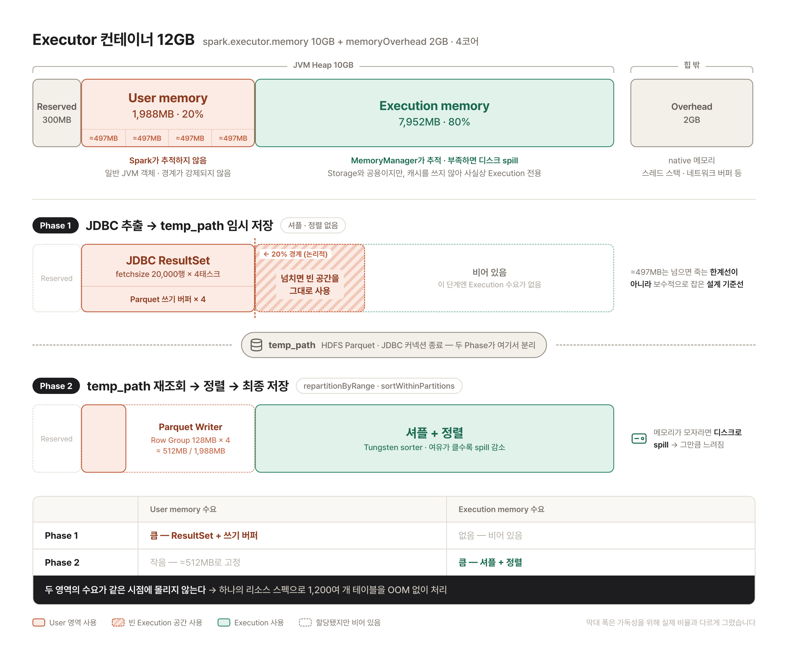

### Phase 1: JDBC 추출 → temp_path 임시 저장

Two-Pass(병렬 추출)의 첫 단계는 파티셔닝된 JDBC 커넥션으로 데이터를 읽어 임시 경로에 그대로 저장하는 작업입니다. 각 태스크가 RDBMS 드라이버를 통해 fetchsize=20000 단위로 데이터를 읽고, 형변환한 뒤 곧바로 Parquet으로 저장합니다. 이때 Parquet으로 저장하는 과정에서 Row Group 크기만큼의 쓰기 버퍼도 함께 사용하므로, Phase 1의 User Memory 수요는 ResultSet과 쓰기 버퍼를 합친 크기가 됩니다(쓰기 버퍼의 동작은 Phase 2에서 자세히 다룹니다). 이 과정엔 셔플이나 정렬이 전혀 없습니다 — repartitionByRange도, sortWithinPartitions도 아직 호출되지 않은 시점이라, Execution Memory 풀(약 7,952MB)은 이 단계에서 사실상 비어 있습니다.

ResultSet은 한 번에 20,000행씩만 메모리에 올라오고 소비되는 즉시 제거되므로, 테이블 전체 크기와 무관하게 순간 메모리 사용량이 고정됩니다. 게다가 이 시점엔 경쟁 상대인 Execution 작업이 없어서, 설계 시 참고했던 태스크당 평균치(약 497MB)를 다소 넘더라도 비어 있는 공간을 사용할 수 있습니다. 즉 497MB는 넘으면 OOM으로 죽는 한계선이 아니라, 컬럼 폭이 제각각인 1,200여 개 테이블을 감당하기 위해 보수적으로 잡아둔 논리적인 설계 기준선에 가깝습니다.

그렇다면 메모리에 여유가 있는 만큼 fetchsize를 더 키우면 입수가 빨라지지 않을까 하는 의문이 남습니다. 실제로 fetchsize를 20,000→30,000→50,000으로 늘려가며 테스트했지만, 이후 구간부터는 입수 시간이 더 줄지 않았습니다. 그 이상은 메모리 사용량만 늘릴 뿐 속도 개선에는 도움이 안 된다는 걸 실측으로 확인하였습니다.

### Phase 2: temp_path 재조회 → 정렬 → 최종 저장

임시 저장이 끝나면 이 데이터를 다시 읽어 파일 사이즈 최적화를 위한 정렬(repartitionByRange → sortWithinPartitions → 최종 write)을 수행합니다. 이 단계는 Phase 1과 메모리 사용 패턴이 정반대입니다.

JDBC 커넥션은 더 이상 존재하지 않습니다. temp_path는 이미 HDFS에 저장된 순수 Parquet 파일이라 DB 연결도, ResultSet 버퍼링도 필요 없습니다. 대신 repartitionByRange의 셔플과 sortWithinPartitions의 정렬이 이때 Execution Memory를 본격적으로 사용합니다. spark.memory.fraction=0.8로 확보해 둔 여유가 실제로 효과를 내는 지점이 바로 여기입니다 — 정렬 대상 데이터가 메모리에 다 들어가지 못해 디스크로 spill되면 그만큼 시간이 늘어나기 때문입니다.

정렬된 데이터는 곧바로 Parquet Writer로 전달돼 최종 파일로 저장됩니다. 이때 Writer는 파일 전체 크기(약 256MB)를 한 번에 버퍼에 들고 있는 게 아니라, Row Group 단위(parquet block size, 기본 128MB)로 차면 flush하고 버퍼를 비웁니다. 즉, 최종 파일과는 무관하게 메모리 사용량은 Row Group 크기로 고정됩니다. 그래서 Phase 2는 Execution(셔플+정렬)과 User(쓰기 버퍼)가 같은 태스크에서 동시에 쓰이는 구간이지만, User 쪽 수요가 "파일 전체"가 아닌 "Row Group 하나"로 제한돼(4코어 동시 기준, 128MB × 4코어 = 약 512MB) 1,988MB 예산 안에서 충분한 여유를 갖습니다.

### 결과적으로

fetchsize=20,000과 fraction=0.8이라는 두 숫자가 충돌 없이 안전할 수 있는 이유는 JDBC 추출(Phase 1)과 셔플+정렬(Phase 2)이 temp_path를 경계로 완전히 분리되어 두 메모리 영역이 같은 시점에 겹치지 않기 때문입니다. Phase 1에서는 비어 있는 Execution Memory가 User Memory 쪽 부담(ResultSet + 쓰기 버퍼)을 흡수하고, Phase 2에서는 JDBC 부담이 이미 사라진 상태에서 Writer가 Row Group 단위로만 User Memory를 소모합니다. 이와 같은 구조적인 메모리 분리 덕에 서로 다른 1,200여 개 테이블이 하나의 리소스 스펙으로 OOM 없이 처리될 수 있었습니다.

---

# 4. 핵심 로직: 어떻게 잘 저장할 것인가

데이터를 빠르게 가져오는 것만큼 중요한 것이 '어떤 형태로 저장할 것인가'입니다. 기존 Sqoop 환경은 Mapper 수에 따라 파일 개수가 결정되는 구조였고, 이는 데이터 크기와 무관하게 파일 개수가 고정된다는 것을 의미합니다. 이 특성은 양쪽 방향 모두에서 문제가 될 수 있습니다.

작은 테이블에서는 데이터가 얼마 되지 않는데도 Mapper 수만큼 파일이 쪼개져 Small File을 양산하게 됩니다. HDFS는 파일 하나하나의 메타데이터를 NameNode 메모리에 유지하기 때문에, 작은 파일이 많아질수록 NameNode에 부담이 가중됩니다.

반대로 큰 테이블에서는 데이터가 아무리 많아도 정해진 개수의 파일에 모두 담기다 보니 파일 하나가 과도하게 커지게 됩니다. 여기에 기존 포맷(Text+Gzip)은 분할(Split)이 불가능하다는 제약이 존재합니다. Split이 되지 않으면 파일 하나를 태스크 하나가 통째로 읽어야 하므로, 읽기 병렬성이 파일 개수에 그대로 묶여버립니다. 데이터는 HDFS에 분산 저장되어 있음에도 정작 조회 시점에는 그 분산의 이점을 활용하지 못하게 됩니다.

Oggre는 이 문제를 해결하기 위해 저장 시점에 파일 개수와 크기를 능동적으로 제어하고, 포맷 역시 Row Group 단위로 분할 조회가 가능한 Parquet으로 전환했습니다.


## 4.1. 실측 기반의 파일 개수 산정

3.1에서 DB 카탈로그를 통해 산정한 테이블 용량은 어디까지나 **원천 DB 기준의 크기**입니다. 이 데이터가 Parquet+Snappy로 변환되고 나면 컬럼 인코딩과 압축 과정을 거치며 실제 용량은 크게 달라지게 됩니다. 압축률은 컬럼 구성과 데이터 분포에 따라 테이블마다 제각각이기 때문에, 원천 용량을 기준으로 파일 개수를 정하면 목표 크기에서 크게 벗어날 수밖에 없습니다.

그래서 Phase 1에서 임시 경로(`temp_path`)에 1차 적재를 마친 뒤, **HDFS에 실제로 기록된 용량을 직접 측정**해 파일 개수를 계산합니다.

```python
# HDFS API를 통해 임시 경로의 실제 물리 용량 측정
fs = temp_path_obj.getFileSystem(self.spark._jsc.hadoopConfiguration())
actual_mb = fs.getContentSummary(temp_path_obj).getLength() / (1024 * 1024)

# 실측 용량 기준으로 목표 파일 개수 산정
target_file_count = max(1, math.ceil(actual_mb / 256))
```

`temp_path`를 경유하는 구조가 다소 우회적으로 보일 수 있지만, 이 단계를 거치기 때문에 압축 후 실제 크기를 기준으로 파일 개수를 정할 수 있습니다. (3.4에서 살펴봤듯, 이 구조는 JDBC 추출과 셔플·정렬의 메모리 사용 구간을 분리해주는 효과도 함께 가져다줍니다.)

## 4.2. Range 파티셔닝과 정렬을 통한 최종 저장

목표 파일 개수가 정해지면, 데이터를 그 개수만큼 균등하게 재분배한 뒤 최종 경로에 저장합니다.

```python
final_df = df.repartitionByRange(target_file_count, target_col) \
             .sortWithinPartitions(target_col)

final_df.write.mode("overwrite") \
    .option("compression", "snappy") \
    .option("maxRecordsPerFile", 0) \
    .format("parquet").save(output_path)
```

단순히 `repartition`으로 파일 개수만 맞출 수도 있지만, `repartitionByRange`와 `sortWithinPartitions`를 함께 사용한 데에는 세 가지 이점이 있습니다.

**첫째, 파일 크기의 균등성입니다.** `repartition`은 해시 기반으로 데이터를 섞기 때문에 데이터 분포에 따라 parquet 파일 크기가 들쭉날쭉해질 수 있습니다. 반면 `repartitionByRange`는 파티션 키의 값 범위를 기준으로 나누므로, 각 파일이 목표 크기에 보다 고르게 수렴합니다.

**둘째, 압축 효율입니다.** Parquet은 컬럼 단위로 데이터를 저장하며 RLE, Dictionary 같은 인코딩을 적용하는데, 이 인코딩들은 **같은 값이 연속으로 모여 있을수록 효율이 좋아집니다.** 데이터가 무작위로 섞여 있으면 각 Row Group에 다양한 값이 흩어져 인코딩 효과가 떨어지지만, 정렬된 상태라면 Row Group마다 좁은 값 구간만 담기게 되어 압축률이 올라갑니다.

**셋째, 조회 시 Pushdown 효율입니다.** Parquet은 각 Row Group마다 컬럼별 min/max 통계를 함께 기록합니다. 조회 시 Spark나 Hive는 이 통계를 먼저 확인해, 조건에 해당하지 않는 Row Group은 아예 읽지 않고 건너뜁니다. 이때도 데이터의 정렬 상태가 Pushdown 성능에 큰 영향을 미칩니다. 데이터가 무작위로 섞여 있으면 모든 Row Group의 min/max가 전체 값 범위에 가깝게 잡히므로 건너뛸 수 있는 구간이 사실상 없습니다. 반면 정렬되어 있으면 Row Group마다 좁거나 겹치지 않는 값 구간을 갖게 되어, 조회 조건에 맞는 극히 일부만 읽고 나머지는 건너뛸 수 있습니다. 파티션 키를 기준으로 정렬해 두는 것은 저장 시점에 미리 조회 성능을 확보해두는 작업입니다. 다만 이 효과는 정렬 기준이 된 컬럼으로 조회할 때 가장 크게 나타납니다.

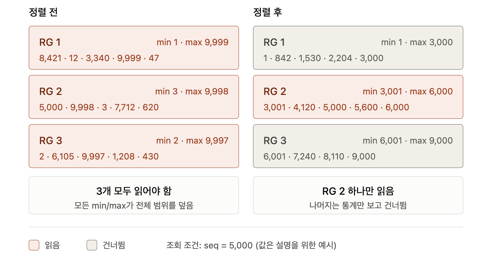

또한 `maxRecordsPerFile=0`을 명시해 레코드 수에 의한 추가 파일 분할을 비활성화했습니다. 기본값도 0이지만, 클러스터 설정과 무관하게 파일 분할 기준을 앞서 계산한 `target_file_count`로만 처리하기 위해 명시했습니다.

최종 저장이 완료되면 임시 경로는 삭제하여, HDFS에 중간 산출물이 남지 않도록 정리합니다.

---

# 5. 성능 검증

지금까지 설계 의도와 구현 방식을 설명했다면, 이번 장에서는 실제 운영 환경에서 측정한 결과를 공유합니다. 검증은 **입수 속도**, **HDFS 파일 사이즈 최적화**, **조회 성능** 세 가지 축으로 진행했습니다.

## 5.1. 입수 속도

동일한 테이블을 기존 Sqoop 파이프라인과 신규 Spark 파이프라인으로 각각 입수하여 소요 시간을 비교했습니다.


| 테이블 | Sqoop | Spark | 감소율 |
|---|---|---|---|
| table_a | 5시간 7분 | 1시간 31분 | 70.4% |
| table_b | 1시간 17분 | 35분 18초 | 54.5% |
| table_c | 5시간 1분 | 3시간 44분 | 25.5% |

| 테이블 | Sqoop | Spark |
|---|---|---|
| table_a | 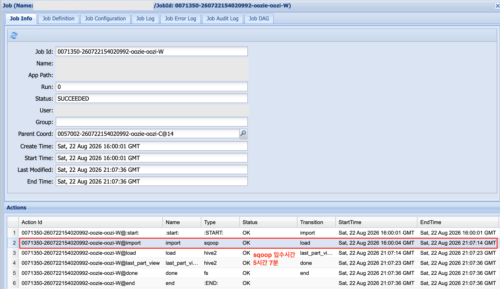 | 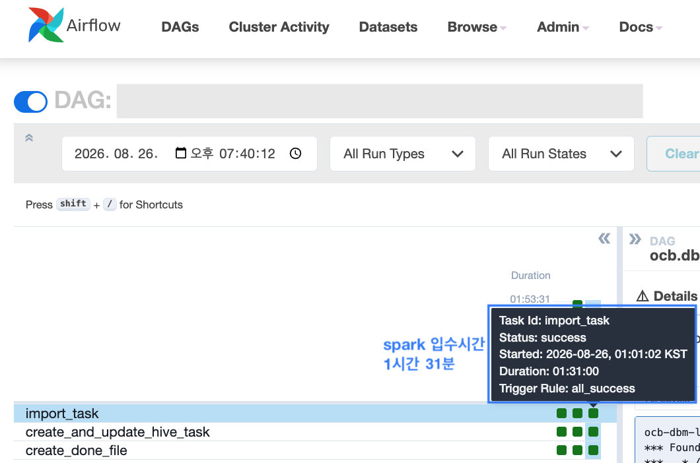 |
| table_b | 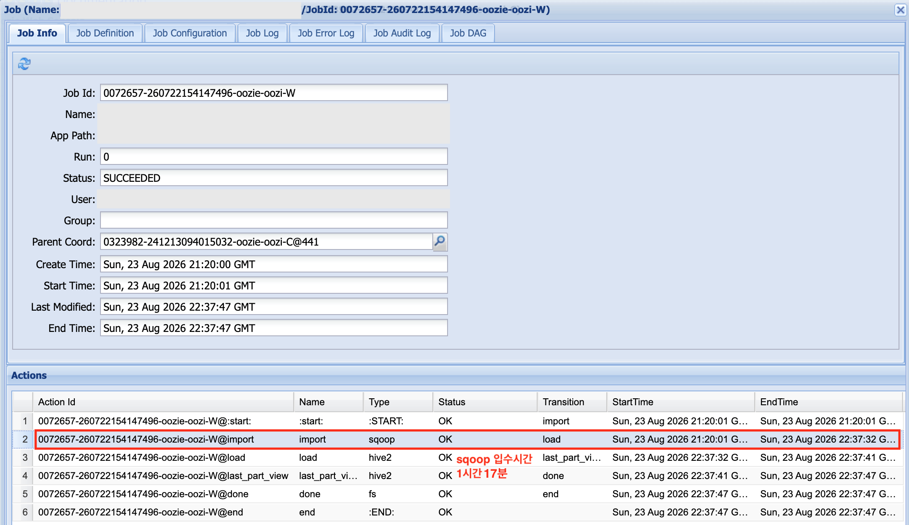 | 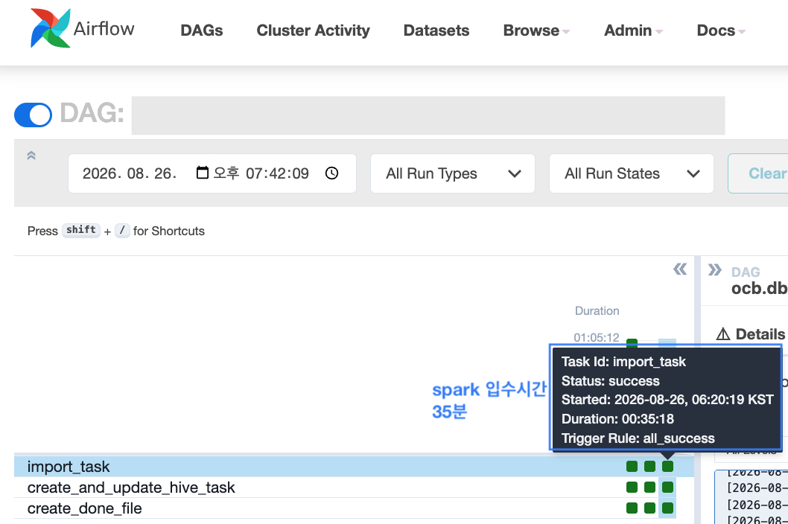 |
| table_c | 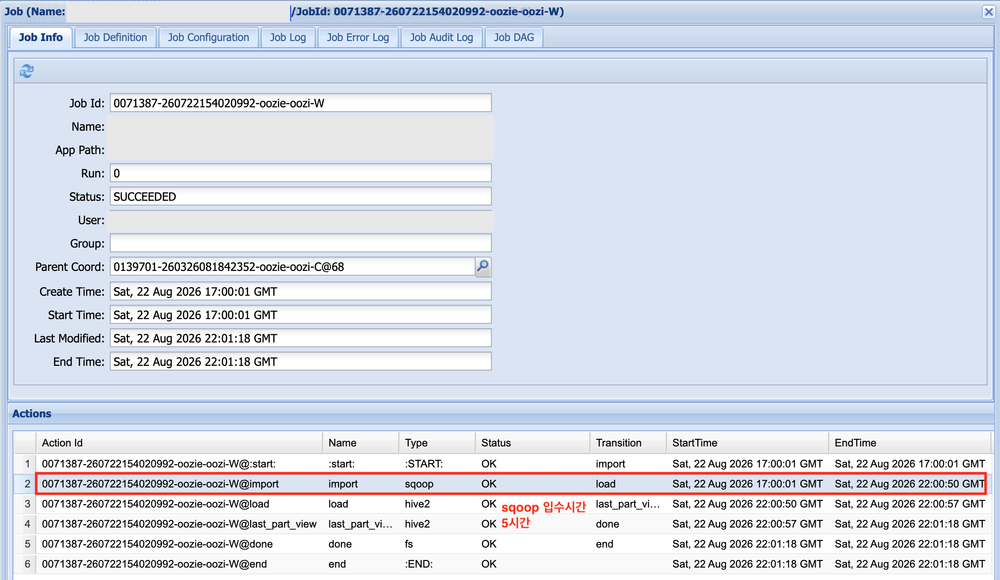 | 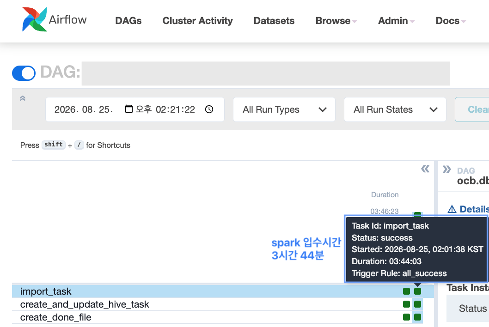 |

대부분의 테이블에서 입수 시간이 단축되었으나, 개선 폭은 테이블마다 큰 차이를 보였습니다. 위 사례에서도 25%에서 70%까지 분포하며, 일부 테이블은 기존과 비슷하거나 소폭 늘어난 경우도 있었습니다.

이 편차는 테이블마다 병렬 처리로 얻을 수 있는 이득의 크기가 다르기 때문입니다. 파티션 키로 선정된 컬럼에 인덱스가 있는지, 데이터가 키 값 범위에 얼마나 고르게 분포하는지에 따라 각 태스크가 실제로 균등하게 일을 나눠 갖는 정도가 달라집니다. 3.2에서 파티션 키 선정 로직에 우선순위 체계를 둔 이유가 바로 이 지점에 있습니다.

## 5.2. HDFS 파일 사이즈 최적화

4장에서 설명했듯 기존 Sqoop 환경의 고정 Mapper 방식은 데이터 크기와 무관하게 파일 개수가 결정되는 구조였고, 이는 양방향으로 문제를 일으켰습니다. 두 가지 사례로 개선 결과를 확인했습니다.

### Small File 억제

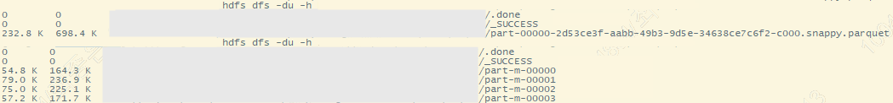

`table_d` 테이블은 일별 데이터가 약 260KB에 불과한 소형 테이블입니다. 기존 레거시(08/17)에서는 이 260KB를 Mapper 수에 맞춰 4개 파일(54.8K, 79.0K, 75.0K, 57.2K)로 쪼개 저장했습니다. HDFS 블록 하나에도 한참 못 미치는 데이터를 굳이 4조각으로 나누었습니다.

신규 파이프라인(08/18)에서는 256MB 이하 테이블이 One-Pass 모드(3.1)로 단일 커넥션에서 추출되므로, 동일한 규모의 데이터가 **232.8KB 단일 파일**로 저장되었습니다. 데이터 크기와 무관하게 파일이 쪼개지던 구조에서, 크기에 맞춰 파일 개수가 결정되는 구조로 바뀌었습니다.

### 파일 분할

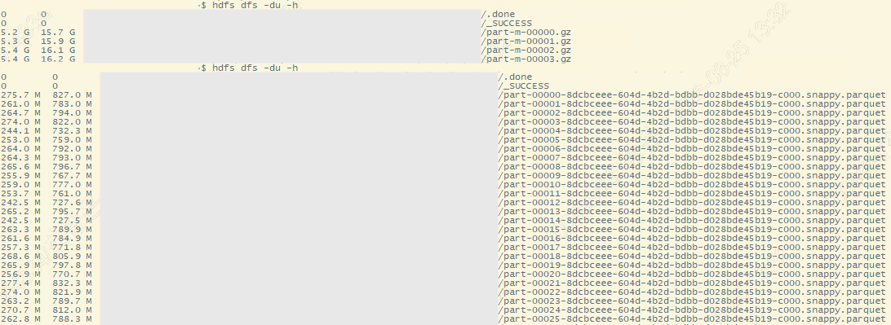

반대 방향의 사례입니다. `table_b`는 대용량 테이블로, 레거시(08/22)에서는 전체 데이터가 **4개 파일(각 5.2G~5.4G)**에 담겼습니다. Text+Gzip은 분할(Split)이 불가능하므로, 이 데이터를 조회할 때 병렬성은 파일 개수인 4로 고정됩니다.

신규 파이프라인(08/23)에서는 동일한 데이터가 **240MB~280MB 수준의 파일 다수**로 분산 저장되었습니다. HDFS 블록 크기를 기준으로 파일 크기가 200MB~300MB 사이에 수렴하도록 산정했고, Parquet은 Row Group 단위 분할 조회가 가능하므로 읽기 병렬성 제약도 함께 해소되었습니다.

### 실측 기반 산정의 효과

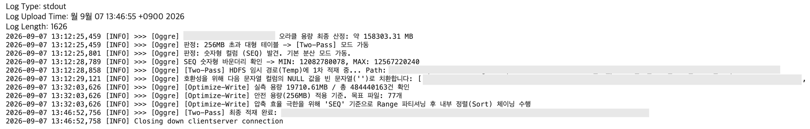

파일 개수 산정이 왜 실측 기반이어야 하는지는 로그에서 확인할 수 있습니다. `TABLE_B` 테이블의 경우, 오라클 카탈로그 기준 용량은 약 **158,303MB**였지만 Parquet+Snappy로 적재된 실제 용량은 **19,710MB**로 약 8배 차이가 났습니다.

만약 원천 DB 용량을 기준으로 파일 개수를 정했다면 약 620개의 파일이 생성되어, 파일 하나당 32MB 수준의 Small File 문제가 발생했을 것입니다. 실측 용량을 기준으로 산정한 결과 목표 파일은 **77개**로 결정되었고, 파일당 256MB라는 목표 크기에 수렴할 수 있었습니다.

## 5.3. 조회 성능

포맷 전환(Text+Gzip → Parquet+Snappy)이 실제 조회 성능에 미친 영향을 확인했습니다. 성격이 다른 두 가지 쿼리로 측정했습니다. 레거시와 신규 파이프라인의 적재 일자가 달라, 레거시는 08/22 파티션, 신규는 08/23 파티션을 기준으로 비교했습니다.

### 특정 값 조회

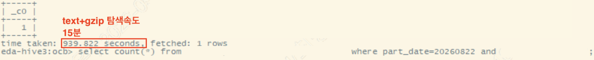

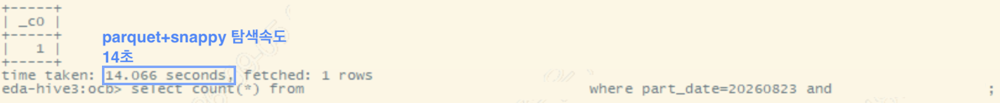

`table_b`에서 `SEQ` 컬럼의 특정 값 하나를 조회했습니다.

```sql
select count(*) from table_b 
where part_date=... and seq='<value>';
```

| 포맷 | 소요 시간 |
|---|---|
| Text+Gzip | 939.8초 (약 15분) |
| Parquet+Snappy | 14.1초 |

약 **66.8배** 단축되었습니다.

### 결과 건수가 많은 조회

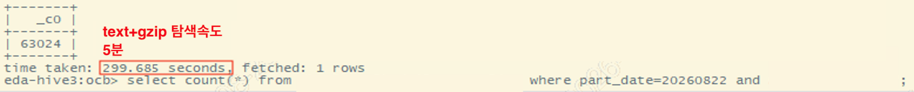

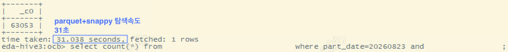

`table_a`에서 `COL_X` 컬럼이 특정 값인 행을 조회했습니다. 신규 기준 63,053건(레거시 08/22 파티션은 63,024건)이 반환되는 쿼리입니다.

```sql
select count(*) from table_a 
where part_date=... and col_x='<value>';
```

| 포맷 | 소요 시간 |
|---|---|
| Text+Gzip | 299.7초 (약 5분) |
| Parquet+Snappy | 31.0초 |

약 **9.7배** 단축되었습니다.

### 개선의 배경

이 차이는 단일 요인이 아니라 세 가지 특성이 함께 작용한 결과입니다. 첫째, Parquet은 컬럼 단위로 데이터를 저장하므로 조회에 필요한 컬럼만 선택적으로 읽습니다. Text 포맷은 조건 컬럼 하나를 확인하기 위해서도 레코드 전체를 읽어야 합니다. 둘째, 4장에서 언급했듯 Text+Gzip은 분할이 불가능해 파일 하나를 태스크 하나가 통째로 읽어야 하는 반면, Parquet은 Row Group 단위 분할이 가능해 읽기 병렬성이 크게 높아집니다. 셋째, 4.2에서 설명한 Row Group Pruning이 동작해 조회 조건에 해당하지 않는 구간을 아예 건너뜁니다.

위의 두 사례의 개선 폭 차이(66.8배 vs 9.7배)를 자세하게 살펴보겠습니다. 특정 값 조회의 조건 컬럼인 `SEQ`는 입수 시 정렬 기준으로 사용된 컬럼이라, 조건에 맞는 데이터가 극히 일부 Row Group에 모여 있어 나머지를 대부분 건너뛸 수 있었습니다. 반면 결과 건수가 많은 조회는 6만 건이 넘는 결과가 여러 Row Group에 걸쳐 있어 실제로 읽어야 할 데이터가 많고, 그만큼 개선 폭이 줄어듭니다. 두 테이블의 크기와 파일 개수가 달라 배수를 직접 비교하기는 어렵지만, 정렬 기준 컬럼으로 좁은 조건을 조회할수록 유리하다는 방향성은 확인할 수 있었습니다.

한 가지 덧붙이면 Row Group Pruning은 정렬 기준이 된 컬럼으로 조회할 때 가장 크게 작용합니다. 다른 컬럼으로 필터링하면 해당 값이 여러 Row Group에 흩어져 있어 건너뛸 수 있는 구간이 줄어듭니다. 3.2의 파티션 키 선정이 입수 속도뿐 아니라 이후 조회 성능까지 함께 좌우하는 지점입니다.

---

# 마치며

1,200여 개의 파이프라인을 전면 개편하는 작업은 결코 단순한 도구 교체가 아니었습니다. Sqoop이 알아서 처리해주던 영역을 하나씩 직접 설계해야 했고, 그 과정에서 그동안 당연하게 여겼던 것들을 다시 들여다보게 되었습니다.

테이블마다 최적의 파티션 키가 무엇인지, JDBC로 읽어온 데이터가 Executor 메모리 어디에 어떻게 쌓이는지, HDFS에 저장되는 파일 하나의 크기가 분석 쿼리의 응답 시간에 어떻게 이어지는지. 편의성 뒤에 가려져 있던 질문들이었고, 이 질문들에 스스로 답을 찾아가는 과정이 이번 프로젝트에서 가장 값진 부분이었다고 생각합니다.

물론 아직 개선의 여지는 남아 있습니다. 입수 시간이 기존과 비슷하거나 소폭 늘어난 테이블들의 원인을 더 정밀하게 분석해야 하고, 파티션 키 선정 로직도 데이터 분포까지 고려하도록 고도화할 수 있습니다. 파일 사이즈 산정 기준 역시 더 정교하게 다듬을 부분이 있습니다. 이번 전환의 가장 큰 의미는 '완성'이 아니라, **개선할 수 있는 구조를 갖추게 되었다는 점**에 있다고 생각합니다. Oozie XML 1,200개를 일일이 수정해야 했던 환경에서는 시도조차 어려웠던 개선들이, 이제는 템플릿 한 곳을 고치는 것으로 전체에 반영될 수 있게 되었습니다.

레거시를 걷어내는 일은 화려하지 않지만, 그 위에 쌓일 다음 작업들을 위해 누군가는 해야 하는 일이라고 생각합니다. 저와 비슷한 고민을 하고 계신 분들께 이 글이 작은 참고가 되었으면 좋겠습니다.

긴 글 읽어주셔서 감사합니다.